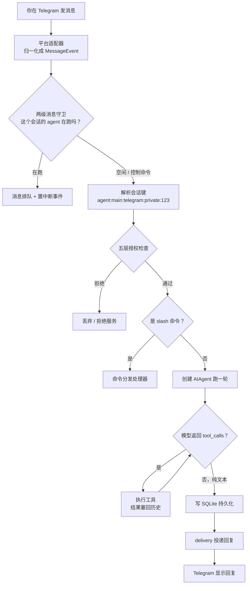
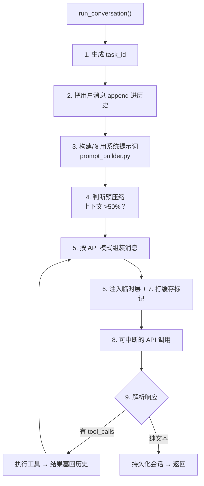

# Hermes 架构 · 一条消息的完整旅程

> 本文把一次「用户在 Telegram 私聊发消息 → Hermes 回复」的全过程拆到底，整合三份官方文档：
> **Gateway Internals**（网关内部）+ **Agent Loop Internals**（Agent 循环）+ **Session Storage**（会话存储）。
>
> 主线例子：你在 Telegram 私聊里给 Hermes 发了一句「帮我看看这个报错」。
>
> 配套本地源码：`~/.hermes/hermes-agent/`（git 源码版，每个模块都能在本地找到对应文件）。

[TOC]

---

## 零、先看全局：一张图看懂整条链路



整条链路就是 **七段**，下面一段一段拆。

---

## 一、进门：适配器归一化

```
Telegram 服务器 push 一条 update（原始 JSON）
      │
      ▼
plugins/platforms/telegram/adapter.py   收到原始事件
      │   把 Telegram 特有格式（chat_id、from、text…）
      │   翻译成统一的 MessageEvent 对象
      ▼
MessageEvent { text, chat_id, chat_type, user_id, platform, ... }
```

**核心思想：每个平台都有自己的「方言」。**

| 平台 | 适配器位置 | 原始事件来源 |
|---|---|---|
| Telegram | `plugins/platforms/telegram/adapter.py` | Bot API（长轮询 / webhook） |
| Discord | `plugins/platforms/discord/adapter.py` | discord.py 的 message |
| Slack | `plugins/platforms/slack/adapter.py` | Socket Mode |
| 飞书/Lark | `plugins/platforms/feishu/adapter.py` | WebSocket / webhook |
| 微信 | `gateway/platforms/weixin.py` | iLink Bot API |
| 钉钉 | `plugins/platforms/dingtalk/adapter.py` | WebSocket |

适配器唯一职责 = 把方言翻译成 **同一个 `MessageEvent`**。从这一刻起，后面所有环节都不知道你来自哪个平台，它们只看 `MessageEvent` 的通用字段。

> 所有适配器都继承 `gateway/platforms/base.py` 的 `BasePlatformAdapter`，实现三个通用接口：
> `connect()` / `disconnect()`（生命周期）+ `send()`（出站）+ 把入站事件归一化成 `MessageEvent` 转给 `handle_message()`。

### 实例：飞书适配器怎么「进门」（`feishu/adapter.py` 的 `connect()`）

先看类定义（第 1484 行），`BasePlatformAdapter` 就是上面说的「所有适配器的基类」：

```python
class FeishuAdapter(BasePlatformAdapter):
```

整个文件 5896 行，核心就是这一个类。它的 `connect()`（第 1774 行）是一个**三层结构**的连接协议：

```python
async def connect(self, *, is_reconnect: bool = False) -> bool:
    # ── 第一层：四道前置校验 ──
    if not self._app_id or not self._app_secret:
        return False                         # 没配 APP_ID/SECRET
    if self._connection_mode not in {"websocket", "webhook"}:
        return False                         # 连接模式不对
    if self._connection_mode == "webhook" and not (...):
        return False                         # webhook 缺 token/key
    if not await asyncio.to_thread(_load_lark_oapi):
        return False                         # 没装 lark-oapi SDK

    try:
        # ── 第二层：抢占 scoped lock ──
        acquired, existing = acquire_scoped_lock("feishu-app-id", self._app_id, ...)
        if not acquired:
            self._set_fatal_error("feishu_app_lock", ..., retryable=False)
            return False                     # 另一个网关占着这个 app_id

        # ── 第三层：真正连接（带重试）──
        self._loop = asyncio.get_running_loop()
        await self._connect_with_retry()
        self._mark_connected()
        return True
    except Exception as exc:
        self._set_fatal_error("feishu_connect_error", ..., retryable=True)
        return False
```

**第一层：四道校验**——读的全是 `.env` 里的配置：`FEISHU_APP_ID`、`FEISHU_CONNECTION_MODE`、`FEISHU_VERIFICATION_TOKEN`、以及飞书官方 SDK `lark-oapi` 装没装。任何一道不过，直接 `return False`，连都不连。

**第二层：`acquire_scoped_lock`**——这就是官方文档「Token Locks」那一节讲的锁。`"feishu-app-id"` 是锁的 scope，`self._app_id` 是锁的身份。作用：**同一个飞书 app_id，两个 Hermes 网关不能同时连**（会抢同一个 websocket）。抢不到就报 `feishu_app_lock`，且 `retryable=False`——因为这是「配置冲突」，重试没用。

**第三层：`_connect_with_retry`**（第 4905 行）——真正连接，带指数退避重试：

```python
async def _connect_with_retry(self):
    for attempt in range(_FEISHU_CONNECT_ATTEMPTS):
        try:
            if self._connection_mode == "websocket":
                await self._connect_websocket()   # 主动去连飞书
            else:
                await self._connect_webhook()     # 本地起 server 等飞书 push
            return
        except Exception as exc:
            wait_seconds = 2 ** attempt           # 1s → 2s → 4s → 8s ...
            await asyncio.sleep(wait_seconds)
```

两种连接模式对应两种「进门姿势」：

| 模式 | 怎么进门 | 类比 |
|---|---|---|
| `websocket` | Hermes **主动**去连飞书服务器，长连接保持 | 你主动打电话给总机 |
| `webhook` | Hermes 在本地**起一个 HTTP server**，飞书主动把事件 push 过来 | 总机反过来打给你 |

websocket 模式里藏着一个真实的坑（`_connect_websocket` 里）：

```python
self._ws_client = FeishuWSClient(
    ...,
    # 不加这个 UA tag，飞书服务器不推「群 @ 消息」
    extra_ua_tags=["channel"],
)
```

注释那句很关键：**不加 `extra_ua_tags=["channel"]`，飞书服务器不会通过 websocket 推群 @ 消息**（对应 issue #50656）。这种「看似无关紧要、其实是踩过坑才补上」的注释，正是读源码最值钱的地方——文档不会写，只有源码里有。

**一句话总结「进门」**：适配器的 `connect()` 本质是一个**连接协议**——先校验配置、再抢独占锁、最后带重试地建立连接（websocket / webhook 二选一）。连上之后，它就进入之前讲的「常驻监听」状态，等飞书把消息推进来，归一化成 `MessageEvent` 交给后面的闸门。

### 补充：`connect()` 的几个高频疑问

#### ① connect() 什么时候发生？——先连接、后收消息

`connect()` 发生在**网关启动时**、**任何消息到来之前**，不是"响应第一条消息"。回到网关工作循环：

```text
① 启动(start) → 加载适配器
② 连接        → connect() 在这里（主动建立连接）
③ 常驻监听    → 等消息进来
④ 收到消息    → 处理（"飞书发消息"这回事到这一步才出现）
```

方向也分两种：websocket 模式下 Hermes **主动**去连飞书；webhook 模式下 Hermes **主动起 server** 等飞书来 push。一句话：**`connect()` 是"开门迎客"，发生在客人（消息）来之前。**

#### ② 连接怎么保持？——心跳 + 自动重连

```python
ws_reconnect_nonce: int = 30        # 重连随机数（默认 30）
ws_reconnect_interval: int = 120    # 断线后 120 秒自动重连
ws_ping_interval: Optional[int] = None    # 心跳间隔
ws_ping_timeout: Optional[int] = None     # 心跳超时
```

- **长连接本身**：websocket 建立后就不挂断。
- **心跳（ping-pong）**：`ws_ping_interval` 定期发 ping 确认"还活着"，防止中间的 NAT/防火墙/负载均衡把"久不通信"的连接判死掐掉。
- **自动重连**：`ws_reconnect_interval = 120`，真断了 120 秒后自动重连；`ws_reconnect_nonce` 是个随机数，防止旧连接的迟到数据包干扰新连接。

这些参数通过 `setattr` 塞给飞书官方 SDK 的 `ws_client`——**保持连接的脏活是 SDK 干的，Hermes 只负责配置它**。

#### ③ websocket vs webhook 完整对比

| | websocket（长连接） | webhook（回调） |
|---|---|---|
| 谁连谁 | Hermes **主动**连飞书 | Hermes 本地起 server，飞书**主动** POST 过来 |
| 连接方式 | 一条**持久双向**通道 | 每次事件 = 一次**独立 HTTP 请求**，处理完就关 |
| 优点 | 实时、双向、**不需要公网 IP** | 简单、无状态 |
| 缺点 | 要维护长连接（心跳+重连） | 飞书要能访问到你的 server（需公网地址/内网穿透） |

类比：**websocket = 一条永远不挂的电话线**，双方随时说话；**webhook = 你留个门牌地址**，飞书有事派人上门送信。

#### ④ scoped lock 详解

`acquire_scoped_lock("feishu-app-id", self._app_id)`：

- **scope**（作用域）= `"feishu-app-id"`，**identity**（锁的键）= 具体 `app_id`
- 锁**按 app_id 区分**：同一个 app_id 只能被一个进程锁住，不同 app_id 互不影响

**为什么需要**：飞书规定同一个 app 只能建立**一条** websocket 连接。若启动两个 Hermes 网关进程（两个 profile / 手动起了两次），它们会用同一个 app_id 去连 → 两个连接打架。scoped lock 让第二个进程抢锁失败、报错退出：

```python
"Another local Hermes gateway is already using this Feishu app_id (PID xxx). Stop the other gateway before starting a second Feishu websocket client."
```

本质：**按 key 分作用域的互斥锁，防止多进程抢占同一个独占资源**——对应官方文档「Token Locks」那一节。

#### ⑤ 连的是「应用」还是「账号」？——是应用（app）

Hermes 连飞书，用的是**应用凭证**，不是某个人的账号密码。

飞书的身份模型：

1. 在飞书开放平台注册一个**自建应用** → 拿到 `App ID`（`cli_xxx`）+ `App Secret`（`secret_xxx`）
2. 在应用里**启用「机器人」**能力
3. Hermes 用 `FEISHU_APP_ID` + `FEISHU_APP_SECRET` 认证
4. 认证通过后，Hermes **扮演这个应用下的机器人身份**

| | 应用（app） | 账号（user） |
|---|---|---|
| 是什么 | 一个"服务/机器人" | 一个真实的"人" |
| 凭证 | App ID + App Secret | 手机号 + 密码 |

代码证据：`_FeishuBotIdentity` 类（第 369 行）就是"机器人身份"：

```python
class _FeishuBotIdentity:
    open_id: str = ""    # 飞书开放平台的 open_id
    user_id: str = ""    # 用户 ID
    name: str = ""       # 机器人名字
```

以及 `_hydrate_bot_identity()`（第 4497 行）——"hydrate" 即"填充"，认证后去加载机器人自己的身份。

类比：**应用 = 公司（App ID/Secret 是营业执照），机器人 = 公司雇的前台员工，Hermes = 让这个员工上岗**。这又呼应了 ④ 里 scoped lock 为什么按 app_id 锁——飞书规定同一个应用只能建立一条 websocket 连接。

#### ⑥ 换飞书账号还能用这个机器人吗？——能，机器人是「企业级」的

机器人不绑定任何账号，它是**应用的能力**，全企业共享。换个账号能不能用，取决于**权限**，而不是"机器人绑在谁身上"：

1. **飞书后台**：应用的「可用范围」（全员 / 部分人）
2. **Hermes 侧**：`.env` 白名单 `FEISHU_ALLOWED_USERS=ou_xxx,ou_yyy`

| 新账号 | 结果 |
|---|---|
| 在范围 + 白名单内 | ✅ 用同一个机器人 |
| 不在 | ❌ 没权限（但机器人没"换主人"） |

如果能用，机器人还是**同一个**（open_id 不变），但 Hermes 把新账号当成**另一个用户**，开一个**独立会话**——因为会话键里的 `chat_id` 就是"正在说话的用户"：

```text
agent:main:feishu:private:{chat_id}
                           ↑ 这个 chat_id 就是"正在跟机器人说话的那个用户"
```

不同账号 = 不同 `chat_id` = 不同会话 = 不同对话历史。所以账号 A 的聊天记录账号 B 看不到，B 从头开始（记忆/会话都独立）。

一句话：**同一个机器人，谁有权限谁用；换个人来用 = 开一间新的私聊房间。**

---

## 二、闸门：两级消息守卫

消息进来前要先过两道闸——这是整条旅程里**最容易被忽略、但最精巧**的部分。

### Level 1 — Base adapter（`gateway/platforms/base.py`）

查 `_active_sessions`：这个会话的 agent 是不是正在跑？

- **正在跑** → 消息塞进 `_pending_messages` 队列，并**置一个中断事件**
- 没在跑 → 放行

### Level 2 — GatewayRunner（`gateway/run.py`）

查 `_running_agents`，拦截特定命令：

- `/stop` `/new` `/queue` `/status` `/approve` `/deny` → 单独路由处理
- 其他任何消息 → 触发 `running_agent.interrupt()`

### 关键细节：`/approve` 为什么要「内联派发」

像 `/approve` 这种「必须在 agent 阻塞时也能到达」的命令，是**内联派发**的（`await self._message_handler(event)` 直接调用），**绕过后台任务系统**。

原因：如果不绕开，会出现死锁——「agent 卡在等审批 → 审批消息还在排队等 agent 结束」。

> **一句话理解闸门：agent 正在干活时你追发消息，消息不会丢，而是排队 + 打断它；但控制命令（stop/approve/deny）永远插队直达。**

---

## 三、找房间：会话键解析

`GatewayRunner._handle_message()` 调 `_session_key_for_source()`，算出这条消息属于哪个「房间」：

```
agent:main:{platform}:{chat_type}:{chat_id}

例如：agent:main:telegram:private:123456789
```

| 字段 | 含义 | 例子 |
|---|---|---|
| `platform` | 平台 | telegram / discord / feishu |
| `chat_type` | 聊天类型 | private（私聊）/ group（群）/ channel |
| `chat_id` | 聊天窗口 ID | 123456789（thread 感知的平台会把帖子/线程 ID 也编进去） |

**这个键决定了「同一个人在不同平台的对话是分开的」**——Telegram 私聊和 Discord 频道是两个房间，虽然用的是同一个 agent 大脑。

它最终落到 `state.db` 的 `sessions.source` 字段。所以你在桌面 App / CLI / 飞书里看到的会话列表，全都靠这个键归位。

> ⚠️ 文档特别警告：**永远不要手搓这个键**，用 `build_session_key()`，因为 thread 编码有坑。

---

## 四、验身份：五层授权

按顺序查，**命中即放行，全部不中即拒绝**：

```
1. 平台级 allow-all    TELEGRAM_ALLOW_ALL_USERS      → 该平台所有人放行
2. 平台级 allowlist    TELEGRAM_ALLOWED_USERS        → 只放行名单里的 user_id
3. DM 配对             pairing                       → 已配对用户放行
4. 全局 allow-all      GATEWAY_ALLOW_ALL_USERS       → 所有平台所有人放行
5. 默认                deny                          → 拒绝
```

### DM 配对流程（pairing）

给「没法预先知道对方 user_id」的场景用：

```
管理员: /pair
网关:   "配对码 ABC123，发给对方"
新用户: ABC123
网关:   "已配对，你现在被授权了"
```

配对状态存在 `gateway/pairing.py`，**重启不丢**。

---

## 五、跑大脑：AIAgent 的一轮对话

这是旅程的正餐。授权通过、不是 slash 命令、agent 也没在跑，`_handle_message()` 就**创建一个 `AIAgent` 实例**跑一轮。

`AIAgent` 是整个 Hermes 的核心引擎（`run_agent.py`）。

### 5.1 两个入口

```python
# 简单接口 —— 返回最终回复字符串
response = agent.chat("帮我看看这个报错")

# 完整接口 —— 返回 dict（消息 + 元数据 + 用量统计）
result = agent.run_conversation(user_message="帮我看看这个报错", task_id="task_abc")
```

`chat()` 是 `run_conversation()` 的薄封装，只取 `final_response` 字段。

### 5.2 一轮内部循环（Turn Lifecycle）



逐步拆：

| 步 | 做什么 | 关键点 |
|---|---|---|
| 1 | 生成 task_id | 每次运行一个唯一标识 |
| 2 | 把用户消息 append 进历史 | 历史是 OpenAI 格式的消息列表 |
| 3 | 构建系统提示词 | `prompt_builder.py` 组装：身份 + 工具指引 + 技能 + 上下文文件 + 记忆 |
| 4 | 预压缩判断 | 超过 50% 上下文就先压缩 |
| 5 | 按 API 模式组装 | 三种模式（见 5.3） |
| 6 | 注入临时层 | 预算警告、上下文压力等 ephemeral 提示 |
| 7 | 打缓存标记 | Anthropic 专属，其他 provider 跳过 |
| 8 | 可中断 API 调用 | 见 5.4 |
| 9 | 解析响应 | 有工具调用就执行再循环；纯文本就结束 |

### 5.3 三种 API 模式

同一个内部格式，对不同的 provider 出口：

| 模式 | 用于 | 客户端 |
|---|---|---|
| `chat_completions` | OpenAI 兼容端点（OpenRouter、DeepSeek、大部分） | `openai.OpenAI` |
| `codex_responses` | OpenAI Codex / Responses API | Responses 格式 |
| `anthropic_messages` | Anthropic 原生 | `anthropic.Anthropic` |

解析顺序：显式参数 → provider 特征（`anthropic` 走 anthropic_messages）→ base_url 启发式（`api.anthropic.com` → anthropic_messages）→ 默认 `chat_completions`。

> 你现在 provider 是 DeepSeek，走 `chat_completions` 这条路。

### 5.4 可中断的 API 调用

这是「第二节那个中断事件」在这里兑现的地方：

```
┌─────────────────────────────────────────────┐
│  主线程                  API 线程            │
│                                          │
│  同时等三件事：            HTTP POST        │
│   - 响应就绪    ─────▶    发给 provider     │
│   - 中断事件                                │
│   - 超时                                    │
└─────────────────────────────────────────────┘
```

HTTP 请求在**后台线程**发，主线程同时等三件事。你一发新消息或 `/stop`，主线程立刻**放弃那个 API 线程**：丢弃响应、不写入历史，干净地转去处理新输入。

### 5.5 工具执行

- **单个工具** → 主线程直接执行
- **多个工具** → `ThreadPoolExecutor` 并发执行（例外：`clarify` 这类交互式工具强制串行），结果按**原始调用顺序**塞回
- **危险命令** → 先走 `tools/approval.py` 检测，危险则触发审批回调等用户确认

每个工具的完整执行流：

```
for each tool_call in response.tool_calls:
    1. 从 tools/registry.py 解析 handler
    2. 触发 pre_tool_call 插件钩子
    3. 检测是否危险命令（tools/approval.py）
       - 危险 → 调 approval_callback，等用户
    4. 执行 handler（带 args + task_id）
    5. 触发 post_tool_call 插件钩子
    6. 把 {"role": "tool", "content": result} 塞回历史
```

**Agent 级工具**（在 `run_agent.py` 就被拦截，不进注册表）：`todo`、`memory`、`session_search`、`delegate_task`——它们直接改 agent 状态，返回合成结果。

### 5.6 消息角色交替铁律

```
system → User → Assistant → User → Assistant → ...

工具调用时：
Assistant(带 tool_calls) → Tool → Tool → ... → Assistant
```

- **绝不允许**两个 assistant 连着
- **绝不允许**两个 user 连着
- **只有** `tool` 角色可以连续出现（并行工具结果）

Provider 会拒收畸形历史。**这也解释了为什么 cron 投递不镜像进网关会话历史——避免破坏这个交替规则。**

### 5.7 预算与回退

- **迭代预算**：默认 500 次迭代（`agent.max_turns`），到 100% 停下返回工作总结；子 agent 独立预算（`delegation.max_iterations`，默认 50）
- **回退模型**：主模型 429/5xx/401 失败时，按 `fallback_providers` 列表依次降级，成功就接着聊；401/403 会先尝试刷新凭证再降级

---

## 六、记账：持久化到 SQLite

每跑完一轮（甚至在压缩前），消息就写进 `~/.hermes/state.db`。

### 6.1 数据库结构

```
~/.hermes/state.db（SQLite，WAL 模式）
├── sessions           — 会话元数据、token 计数、费用
├── messages           — 每个会话的完整消息历史
├── session_model_usage— 按模型/任务的使用量归因
├── messages_fts       — FTS5 全文索引
├── messages_fts_trigram — FTS5（trigram 分词，给中文/CJK 子串搜索）
├── gateway_routing    — 网关路由元数据
└── ...（压缩锁、投递账本、schema 版本等）
```

### 6.2 两张核心表

**sessions 表**（存元数据）：

| 关键字段 | 含义 |
|---|---|
| `id` | 会话唯一 ID（主键） |
| `source` | 会话键，如 `agent:main:telegram:private:123` |
| `model` / `model_config` | 用哪个模型 |
| `parent_session_id` | 父会话（压缩分裂时的 lineage） |
| `started_at` / `ended_at` / `end_reason` | 生命周期 |
| `input_tokens` / `output_tokens` / `reasoning_tokens` | token 统计 |
| `estimated_cost_usd` / `actual_cost_usd` | 费用 |

**messages 表**（存历史）：

| 关键字段 | 含义 |
|---|---|
| `session_id` | 属于哪个会话 |
| `role` | system / user / assistant / tool |
| `content` | 文本内容 |
| `tool_calls` | 工具调用（JSON 字符串） |
| `tool_call_id` / `tool_name` | 工具调用关联 |
| `reasoning` / `reasoning_content` | 推理内容 |

### 6.3 写竞争处理

多个 hermes 进程（网关 + CLI + worktree agent）共享一个 `state.db`，靠这些避免冲突：

- 短 SQLite 超时（1 秒）
- 应用层重试 + 随机抖动（20–150ms，最多 15 次）
- `BEGIN IMMEDIATE` 事务
- 每 50 次成功写触发一次 WAL checkpoint

> **「会话能 resume」的本质：这轮对话的每一条消息都被落进了 `sessions` + `messages` 两张表。**

---

## 七、回信：投递

`gateway/delivery.py` 负责把回复送回正确的地方，四种路径：

| 投递路径 | 说明 |
|---|---|
| **直接回复** | 回到发消息的那个聊天窗口 |
| **home channel** | cron 结果/后台产出送到你配的「主频道」（飞书里 `/set-home` 标记） |
| **显式目标** | 明确指定 `telegram:-1001234567890`（cron 的 `deliver:` 目标、`hermes send`） |
| **跨平台** | 回复到一个**和发消息不同的平台** |

> cron 投递**不会**镜像进网关会话历史——它们只存在自己的 cron 会话里，这是为了避免破坏角色交替规则。

---

## 八、一镜到底总结

把整条旅程压缩成一句话：

> **适配器翻译 → 两级守卫排队/放行 → 会话键定房间 → 五层授权验身份 → AIAgent 循环（调模型 → 执行工具 → 再调模型）→ 写 SQLite → delivery 回信。**

对应到 `~/.hermes/gateway_state.json` 里的字段：

- `active_agents` = 此刻有多少个 `AIAgent` 在跑
- `platforms` = 挂了哪些平台适配器
- `gateway_state: running` = 网关进程活着

---

## 附录：三份官方文档 + 本地源码对照

### 官方文档（Developer Guide）

| 文档 | 网址 |
|---|---|
| Architecture | `/docs/developer-guide/architecture` |
| Agent Loop Internals | `/docs/developer-guide/agent-loop` |
| Prompt Assembly | `/docs/developer-guide/prompt-assembly` |
| Provider Runtime | `/docs/developer-guide/provider-runtime` |
| Session Storage | `/docs/developer-guide/session-storage` |
| Gateway Internals | `/docs/developer-guide/gateway-internals` |
| Context Compression & Caching | `/docs/developer-guide/context-compression-and-caching` |

> 完整入口：`https://hermes-agent.nousresearch.com/docs/llms.txt`（整个文档集的索引）。

### 本地源码锚点（`~/.hermes/hermes-agent/`）

| 文件 | 对应本文的环节 |
|---|---|
| `run_agent.py` | 第五节：AIAgent 核心循环 |
| `agent/prompt_builder.py` | 5.2 第 3 步：系统提示词组装 |
| `model_tools.py` | 工具发现 + 分发 |
| `tools/registry.py` | 工具注册表 |
| `tools/approval.py` | 危险命令检测 |
| `hermes_state.py` | 第六节：SQLite 持久化 |
| `gateway/run.py` | 第二节 Level 2 + 第三节：主循环/会话键 |
| `gateway/session.py` | 会话键构造 + SessionStore |
| `gateway/delivery.py` | 第七节：投递 |
| `gateway/pairing.py` | 第四节：DM 配对 |
| `plugins/platforms/telegram/adapter.py` | 第一节：Telegram 适配器 |

### 两条设计公理（来自源码 `AGENTS.md`，理解一切的钥匙）

> 1. **Per-conversation prompt caching is sacred**（每轮对话的 prompt 缓存是神圣的）——长对话每轮复用缓存前缀，任何中途改历史/换工具集/重建系统提示词的操作都会击穿缓存、成本翻倍。所以铁律是：**除压缩外，绝不在对话中途改动上下文。**
>
> 2. **The core is a narrow waist; capability lives at the edges**（核心是窄腰，能力长在边缘）——每个核心工具每次 API 调用都会带上，进核心门槛极高。新能力优先：扩展现有代码 → CLI 命令+skill → service-gated 工具 → plugin → MCP → 最后才加核心工具。
