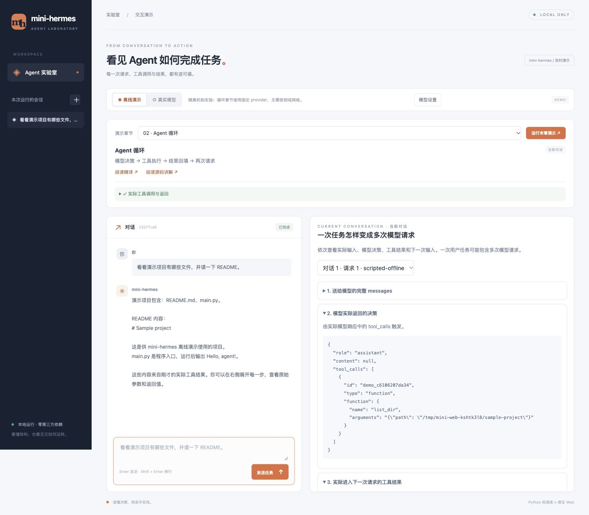

# mini-hermes — Learn Agent Architecture by Building It

[简体中文](README.md) | **English**

A runnable learning project built with the Python standard library, alongside chapter-by-chapter Chinese translations and implementation notes for selected sections of the [Hermes Agent Developer Guide](https://github.com/NousResearch/hermes-agent/tree/f5d192611032025d2757b07ad838921872126182/website/docs/developer-guide).

The goal is to understand the architectural decisions by implementing them: the agent loop, tool dispatch, prompt assembly, context compression, session storage, and extension points.

This repository contains **17 Chinese translation chapters**, **16 source walkthroughs**, and a working mini agent. This English page covers the project, setup, and reading routes; the chapter documents and most CLI messages are currently in Chinese.

## Start here

| What you want to do | Where to go |
|---|---|
| Run the implementation | [Quick start](#quick-start) · [Detailed CLI guide, Chinese](mini-hermes/README.md) |
| Read from the beginning | [Architecture overview](中文精译-01-Architecture.md) → [Chapter index](#chapter-index) |
| Follow a message through the system | [A message's complete journey](Hermes消息完整旅程.md) |
| Explore code and testing | [Code walkthrough](代码解读-mini-hermes.md) · [How the tests work](测试怎么写.md) |
| Review scope and validation | [Project overview and remaining gaps](收尾总览.md) · [Fixes and verification receipts](发布前修复记录.md) |

## What you can explore

- **Agent loop and tool dispatch:** conversation state, execution order, tool registration, and toolset visibility.
- **Prompt assembly and context management:** stable prompt prefixes, summarization, micro-compaction, and provider usage accounting.
- **Persistence and recovery:** SQLite sessions, full-text search, degraded search, read-only health checks, and explicit repair.
- **Gateway lifecycle:** console input, queues, session rotation, agent caching, and profile isolation.
- **Provider routing and extensions:** fallback rules, auxiliary models, discoverable skills, replaceable context engines, and read-only observers.
- **Tests of behavior:** assertions about ordering, boundaries, and side effects, with reverse checks that demonstrate failures when old behavior is restored.

## Web demo

Requires **Python 3.9+**, with no `pip install` or `npm install` step. In a macOS / Linux terminal:

```bash
git clone https://github.com/ICTQYC/mini-hermes-study.git
cd mini-hermes-study
./mini-hermes/mini --web
```

Open [http://127.0.0.1:8765](http://127.0.0.1:8765/). Offline mode needs no key or network. If you already have the repository, run only the last command from its root. Press **Ctrl-C** to stop. If the port is in use, run `./mini-hermes/mini --web --web-port 8766` and open that port.

Select a chapter to run a focused mechanism experiment and inspect measured evidence. Agent-loop chapters use scripted decisions with real tools offline. Enter a DeepSeek API key in Model settings (server memory only), then switch to live mode; existing backend configuration is also supported. No frontend build or third-party packages are needed. See the [Web demo guide](WEB_DEMO.md). Chapter 03 now shows the actual prompt tiers and each request in the current conversation: [Prompt assembly demo](WEB_PROMPT_ASSEMBLY.md). [Chapter demo guide](WEB_CHAPTER_DEMOS.md).



## Quick start

Requires **Python 3.9+**. There are **no third-party Python dependencies**, and no `pip install` step. The Bash launcher targets macOS and Linux. Native Windows shells have not been validated; use a compatible Bash environment.

From the repository root, list the available tools without API credentials:

```bash
./mini-hermes/mini --list-toolsets
```

For help and network diagnostics:

```bash
./mini-hermes/mini -h
./mini-hermes/mini --doctor
```

The diagnostic command needs no model API key, but it makes network probes. The tool listing and test suite can run offline.

### Call a real model

The default provider is DeepSeek. Create `~/.mini-hermes/.env` with a local editor and set `DEEPSEEK_API_KEY` there. Keep the key out of shell commands and Git.

```bash
mkdir -p ~/.mini-hermes
# Open ~/.mini-hermes/.env in a local editor and configure DEEPSEEK_API_KEY.
./mini-hermes/mini -q "List the files in this directory."
```

Credential files are checked in this order: `MINI_ENV_FILE`, `$MINI_HOME/.env` (default: `~/.mini-hermes/.env`), then `~/.hermes/.env`. Real model calls require credentials and network access. See the [CLI guide](mini-hermes/README.md) for provider configuration and other commands.

### Optional command installation

```bash
./mini-hermes/install.sh
```

This creates a launcher symlink in `~/.local/bin` and reports any required PATH change. When invoked from another directory, `mini` uses that directory as its workspace.

## Run the tests

Tests are standalone standard-library scripts; neither pytest nor API credentials are required.

```bash
cd mini-hermes
find . -name __pycache__ -type d -exec rm -rf {} +
for f in tests/test_*.py; do
    echo "── $f"
    python3 "$f" || exit 1
done
```

Verified results across 18 test files: **1,910 passing assertions on Python 3.13.14** and **1,906 on Python 3.9.6**, with zero failures. The four-assertion difference comes from a physical FTS corruption branch that the tested Python 3.9 SQLite build prevents from being created.

Both versions also passed with `python3 -S`, disabling site-packages, in an isolated HOME without credentials. These are recorded validation results, not a guarantee for every OS or SQLite build. See the [verification record](发布前修复记录.md).

Demo requirements vary: the model demos need credentials and network access; the storage, skills, context-engine, and observer demos use local data or fake providers. Check each script's description before running it.

## Chapter index

The links below open the Chinese Markdown documents directly on GitHub. “Translation” explains the upstream guide; “walkthrough” compares the implementations, examines design choices, and records gaps and fixes.

| Chapter | Topic | Translation | Walkthrough |
|---|---|---|---|
| 01 | Architecture | [Read](中文精译-01-Architecture.md) | — |
| 02 | Agent loop | [Read](中文精译-02-AgentLoop.md) | [Read](源码讲解-02-AgentLoop.md) |
| 03 | Prompt assembly | [Read](中文精译-03-PromptAssembly.md) | [Read](源码讲解-03-PromptAssembly.md) |
| 04 | Tools runtime | [Read](中文精译-04-ToolsRuntime.md) | [Read](源码讲解-04-ToolsRuntime.md) |
| 05 | Context compression and caching | [Read](中文精译-05-ContextCompressionAndCaching.md) | [Read](源码讲解-05-ContextCompressionAndCaching.md) |
| 06 | Session storage | [Read](中文精译-06-SessionStorage.md) | [Read](源码讲解-06-SessionStorage.md) |
| 07 | Gateway internals | [Read](中文精译-07-GatewayInternals.md) | [Read](源码讲解-07-GatewayInternals.md) |
| 07b | Gateway session lifecycle | [Read](中文精译-07b-GatewaySessionLifecycle.md) | [Read](源码讲解-07b-GatewaySessionLifecycle.md) |
| 07c | Gateway multiplexing | [Read](中文精译-07c-MultiplexingGateway.md) | [Read](源码讲解-07c-MultiplexingGateway.md) |
| 08 | Provider runtime | [Read](中文精译-08-ProviderRuntime.md) | [Read](源码讲解-08-ProviderRuntime.md) |
| 09 | Programmatic integration | [Read](中文精译-09-ProgrammaticIntegration.md) | [Read](源码讲解-09-ProgrammaticIntegration.md) |
| 10 | Micro-compaction | [Read](中文精译-10-MicroCompaction.md) | [Read](源码讲解-10-MicroCompaction.md) |
| 11 | State database recovery | [Read](中文精译-11-StateDbRecovery.md) | [Read](源码讲解-11-StateDbRecovery.md) |
| 12 | Codebase ownership and completion backlog | [Read](中文精译-12-CodebaseOwnershipAndCompletionBacklog.md) | [Read](源码讲解-12-CodebaseOwnershipAndCompletionBacklog.md) |
| 13 | Creating skills | [Read](中文精译-13-CreatingSkills.md) | [Read](源码讲解-13-CreatingSkills.md) |
| 14 | Context engine plugin | [Read](中文精译-14-ContextEnginePlugin.md) | [Read](源码讲解-14-ContextEnginePlugin.md) |
| 15 | Observer hooks | [Read](中文精译-15-ObserverHooks.md) | [Read](源码讲解-15-ObserverHooks.md) |

Chapters 07b and 07c extend the gateway chapter. Chapter 01 is a map without an implementation walkthrough; chapters 09 and 12 have no corresponding new implementation subsystem. Bundled skills are covered within chapter 13.

## Repository layout

```text
mini-hermes/                  Runnable implementation
  agent/                      Loop support, prompts, compression, extension hooks
  tools/                      Tools and registration
  providers/                  Provider adapters
  gateway/                    Console gateway and session lifecycle
  hermes_cli/                 Configuration and CLI commands
  skills/                     Bundled skills
  tests/                      Standalone test scripts
  demos/                      Demonstrations and failure reproductions
中文精译-*.md                  Chinese translations
源码讲解-*.md                  Source walkthroughs and implementation comparisons
```

## Historical snapshots

The public history has been sanitized to remove local paths and personal email addresses. Local commit references and chapter tags have been updated to match this public history.

Use the current main branch to run the maintained implementation. Chapter tags and `final-v1` preserve earlier milestones, but some chapter tags were moved during earlier maintenance. For historical code and line references, use the explicit commit recorded in each document rather than assuming every tag identifies the original chapter snapshot. The [implementation README](mini-hermes/README.md) lists the historical commits.

## Scope

This is a learning implementation. It does not include the upstream cron subsystem, general plugin system, subagents, multiple messaging-platform adapters, or TUI. It provides skills, context-engine, and observer extension points, and a console gateway. Detailed differences are recorded in the chapter walkthroughs and [gap summary](收尾总览.md).

## Attribution and license

Hermes Agent is developed by [Nous Research](https://nousresearch.com). This is an independent learning project, unaffiliated with the official project.

Original material in this repository is covered by the [MIT license](LICENSE). Translations and quotations retain the upstream attribution and MIT permission notice; see [third-party notices](THIRD_PARTY_NOTICES.md). See [Hermes Agent](https://github.com/NousResearch/hermes-agent) and the [official documentation](https://hermes-agent.nousresearch.com/docs) for the source material.

The local `官方文档-Developer-Guide/` mirror is ignored by Git and is not distributed in this repository. The [Chinese README](README.md#快速开始) explains how to obtain the upstream documentation at the reference commit. You can read this repository and run its tests without that mirror.
