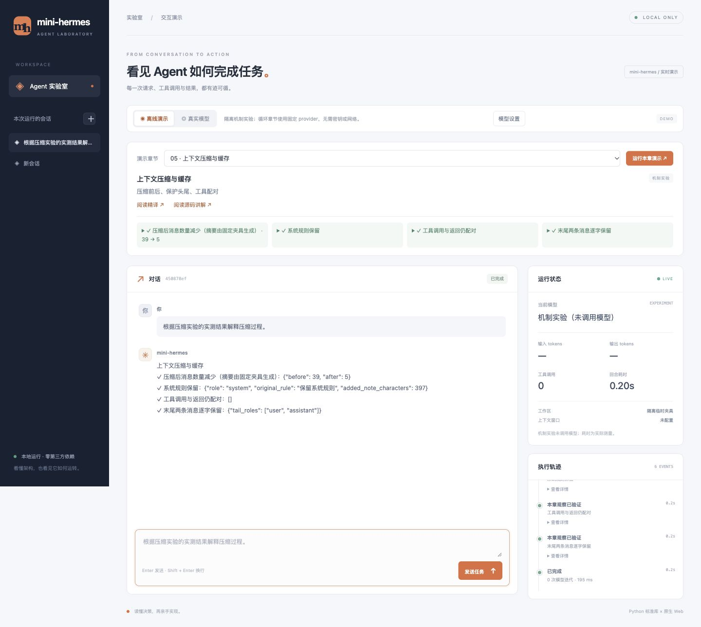

# 手写一个能跑的 Agent：逐章精读 Hermes 并复刻一个迷你版

**简体中文** | [English](README.en.md)

**一句话**：逐章精读 [Hermes Agent](https://github.com/NousResearch/hermes-agent) 官方 Developer Guide 的选定章节，并把对应机制在一个零依赖的迷你版实现里手写一遍 —— 目前 **17 篇中文精译 + 16 篇源码讲解 + 一个约 2 万行的迷你 agent**。

一个从零手写的、真正能跑的 agent，目的是搞懂 Hermes 怎么实现的。**抄的是架构决策，不是代码量。**

## 从这里开始

| 你想做什么 | 入口 |
|---|---|
| 先运行，再看实现 | [快速开始](#快速开始) · [mini 使用说明](mini-hermes/README.md) |
| 从第一章系统阅读 | [架构总览](中文精译-01-Architecture.md) → [章节目录](#内容地图) |
| 跟踪一条消息怎么流转 | [Hermes 消息完整旅程](Hermes消息完整旅程.md) |
| 逐文件看代码与测试 | [代码解读](代码解读-mini-hermes.md) · [测试怎么写](测试怎么写.md) |
| 看实现边界与验证记录 | [收尾总览](收尾总览.md) · [发布前修复记录](发布前修复记录.md) |

英文入口提供项目介绍、运行方式和章节导航；正文精译与讲解目前以中文为主。

## 为什么值得读

带走的是「架构怎么定的」，每一条都能在自己的项目里复用：

- **窄腰与插槽**：核心是一根「窄腰」，能力长在边缘。迷你版把上下文压缩器做成了**可替换插槽** —— 换引擎只改一处构造点，且默认路径**逐字节不变**。这是「扩展点该开在哪」的现成实例。
- **失败语义**：回退链只在「换个环境重试有可能成功」的状态码上回退（429/5xx/401/403 回退，400/422 绝不）；压缩摘要失败分四层（终止类总是中止、非终止类走确定性兜底、再叠冷却阶梯）。读的是「出错了怎么办」的设计。
- **字节稳定**：同一会话内反复构建系统提示词，**字节必须完全相同**。若文件内容变化，反复读取可能缩短可复用的提示词前缀，增加模型输入成本；具体影响取决于 provider 的缓存规则与实际请求。
- **零成本钩子**：只读观察者用 `has()` 查询订阅表实现快路径 —— 没装观察者时，载荷在构造之前就被掐掉，接近零开销。
- **静默失败是主角**：注册了但没在任何 toolset 里点名的工具会**静默消失**（不报错、日志干净）；一个未绑定的读取会**静默串库**（不报错，只是用了别人的数据）。整套材料反复在讲「不报错的错最贵」。
- **测试守的是不变量**：机制自测断言关系（顺序 / 计数 / 边界），反向验证要求「把机制改回旧写法，测试必**干净地变红**」。

## 演示页面

运行 `./mini-hermes/mini --web`，打开 `http://127.0.0.1:8765`，即可体验无需密钥的离线演示。
选择章节可运行本章重点实验、查看实测证据和配套 Markdown；页面实时展示对话与调用轨迹。“模型设置”支持输入 DeepSeek API Key（仅服务内存），切换真实模型运行。详见 [Web 演示说明](WEB_DEMO.md)。 第 3 章已支持查看当前对话的真实提示词分层与每次请求：[演示操作说明](WEB_PROMPT_ASSEMBLY.md)。 [逐章演示指南](WEB_CHAPTER_DEMOS.md)。



## 快速开始

零第三方依赖，只用 Python 标准库；需要 Python **3.9+**（3.9.6 与 3.13.14 都实测跑过全套测试）。

### 开箱即用清单

**clone 下来直接就能跑的**：`./mini-hermes/mini --list-toolsets`、`./mini-hermes/mini --doctor`（**不需要密钥**）；
测试套件也不需要密钥（自带假密钥与假 provider）—— 在**干净 HOME 的克隆**里实测 **1,910 / 1,906 · 0 失败**。

**要自己准备的三样**（前两样按需）：

| # | 要什么 | 用在哪 | 怎么办 |
|---|---|---|---|
| ① | **一个 provider 密钥**（默认 DeepSeek，也可换别家） | 真问答（要调 API） | 在 `~/.mini-hermes/.env` 中用本地编辑器填写 `DEEPSEEK_API_KEY`（不要把值写进 shell 命令）；没配时报错会列出查过哪几个文件 |
| ② | 上游**文档镜像**（可选） | 各章「原文：`官方文档-Developer-Guide/…`」的引用 | 下面的同步命令（上游内容是别人的，**不随仓分发**） |
| ③ | 上游**源码**（可选） | 各章「真实源码 `文件:行号`」的引用（锚上游 commit `f5d1926110`） | `git clone https://github.com/NousResearch/hermes-agent ~/.hermes/hermes-agent`（或忽略行号，只看结论） |

**②的同步命令**（在仓库根跑一次；镜像目录是 gitignore 的）：

```bash
git clone https://github.com/NousResearch/hermes-agent /tmp/hermes-agent
git -C /tmp/hermes-agent checkout f5d192611032025d2757b07ad838921872126182
mkdir -p 官方文档-Developer-Guide
cp /tmp/hermes-agent/website/docs/developer-guide/*.md 官方文档-Developer-Guide/
ls 官方文档-Developer-Guide/*.md | wc -l    # 查看实际同步篇数；章节行号以固定提交为准
```

**平台**：`mini` 是 bash 启动脚本 + 纯标准库 ⇒ **macOS / Linux 直接跑**；

### 装成全局命令（可选）

装完之后，**在任意目录敲 `mini` 就能用**；而且**工作区 = 你敲命令时所在的目录**
（启动器把调用目录记在 `MINI_LAUNCH_CWD`，所以你在某个项目里敲 `mini`，agent 的工作区就是那个项目）。

```bash
./mini-hermes/install.sh                    # 默认装到 ~/.local/bin
./mini-hermes/install.sh /usr/local/bin     # 或指定目录（Homebrew 用户通常可直接写）
```

脚本只做三件事：建一个符号链接 → 不在 PATH 里就告诉你加哪一行 → **自检一次**（`mini --list-toolsets`）。
卸载：`rm ~/.local/bin/mini`（它只建链接，不写别的东西）。

启动器**自己会解开符号链接**（绝对 / 相对链接 / 链的链都行）—— 这条能力有契约测试守着：
`tests/test_packaging.py::test_launcher_via_symlink`（它甚至把「macOS 上 `/var` 是 `/private/var` 的符号链接，
不 `.resolve()` 算相对路径会多退一级」那个坑写在了注释里）。
**Windows 需要 WSL 或 Git-Bash**（没在原生 cmd / PowerShell 上验证过）。

**跑 mini**：

```bash
# 放一个密钥（DeepSeek）
mkdir -p ~/.mini-hermes
# 用本地编辑器打开 ~/.mini-hermes/.env，填写 DEEPSEEK_API_KEY；不要把值粘进 shell 命令

# 不需要密钥的两条
./mini-hermes/mini --list-toolsets    # 列出 toolset 与工具 → 5 个 toolset / 8 个工具名额
./mini-hermes/mini --doctor           # 网络分层体检，末尾给一句结论

# 真跑一次
./mini-hermes/mini -q "这个目录里有哪些文件？"
```

密钥查找顺序（**先找到的赢**）：`MINI_ENV_FILE` → `$MINI_HOME/.env`（默认 `~/.mini-hermes/.env`）→ `~/.hermes/.env`。没配密钥时的报错会直接告诉你这三条路径。

**跑测试**：

```bash
cd mini-hermes
find . -name __pycache__ -type d -exec rm -rf {} +
for f in tests/test_*.py; do echo "── $f"; python3 "$f" | tail -1; done
```

用两个解释器各跑一遍，期望 **1,910 通过 / 0 失败**（3.13.14）与 **1,906 通过 / 0 失败**（3.9.6），共 **18 个测试文件**。差额 4 条是因为 3.9 的 SQLite 拒 `DROP messages_fts_data`，那条真损坏分支造不出来。

跑之前先清 `__pycache__`：`.pyc` 的失效判据是 `(mtime, size)`，**两块长度相同的代码对调**会被判成新鲜缓存，实际跑的是旧字节码。

发布前修复与验证明细见 [发布前修复记录](发布前修复记录.md)。章节标签曾移到后续统一维护提交；历史行号和规模须按正文注明的具体提交核对，不能仅凭 `chXX` 标签复现原章状态。

公开历史已脱敏：本机路径及个人邮箱已移除，正文中的本仓提交引用与章节标签已同步到公开历史。

## 内容地图

| 板块 | 篇数 / 规模 |
|---|---|
| 中文精译（每章一篇，翻译为主，目标看懂原理） | **17 篇** · 11,599 行 |
| 源码讲解（差异 / 深挖 / 真问题 / 差距清单） | 16 篇 · 19,028 行 |
| 跟读文档（消息旅程 / 代码解读 / 测试怎么写） | 3 份 · 2,073 行 |
| 收尾总览（46 篇图谱 / 差距总账 / 冻结清单 —— 全库的账） | 1 篇 · 466 行 |
| 发布前修复记录（问题 → 修复 → 回归与反向验证） | 1 篇 · 172 行 |
| `mini-hermes/` 源码（`*.py`，不含测试 / demo） | 19,768 行 · 79 个文件 |
| `mini-hermes/tests/`（18 个测试文件） | 12,942 行 |
| `mini-hermes/demos/`（故障复现 + 真跑脚本） | 1,794 行 · 10 个 |

**17 章清单**（精译 / 源码讲解行数为实测）：

| 章 | 主题 | 精译 | 源码讲解 |
|---|---|---|---|
| 01 | Architecture（架构总览：地图章，无源码讲解） | [473](中文精译-01-Architecture.md) | — |
| 02 | Agent Loop（回合循环） | [1214](中文精译-02-AgentLoop.md) | [563](源码讲解-02-AgentLoop.md) |
| 03 | Prompt Assembly（提示词装配） | [2202](中文精译-03-PromptAssembly.md) | [973](源码讲解-03-PromptAssembly.md) |
| 04 | Tools Runtime（工具运行时） | [934](中文精译-04-ToolsRuntime.md) | [2852](源码讲解-04-ToolsRuntime.md) |
| 05 | Context Compression & Caching（压缩与缓存） | [931](中文精译-05-ContextCompressionAndCaching.md) | [1774](源码讲解-05-ContextCompressionAndCaching.md) |
| 06 | Session Storage（会话存储） | [812](中文精译-06-SessionStorage.md) | [1059](源码讲解-06-SessionStorage.md) |
| 07 | Gateway Internals（网关内部） | [638](中文精译-07-GatewayInternals.md) | [937](源码讲解-07-GatewayInternals.md) |
| 07b · 扩展 7.1 | Gateway Session Lifecycle（网关会话生命周期） | [903](中文精译-07b-GatewaySessionLifecycle.md) | [1376](源码讲解-07b-GatewaySessionLifecycle.md) |
| 07c · 扩展 7.2 | Multiplexing Gateway（多路复用网关） | [472](中文精译-07c-MultiplexingGateway.md) | [1292](源码讲解-07c-MultiplexingGateway.md) |
| 08 | Provider Runtime（服务商运行时） | [366](中文精译-08-ProviderRuntime.md) | [990](源码讲解-08-ProviderRuntime.md) |
| 09 | Programmatic Integration（程序化集成） | [284](中文精译-09-ProgrammaticIntegration.md) | [788](源码讲解-09-ProgrammaticIntegration.md) |
| 10 | Micro Compaction（微压缩） | [362](中文精译-10-MicroCompaction.md) | [851](源码讲解-10-MicroCompaction.md) |
| 11 | State DB Recovery（state.db 抢修） | [172](中文精译-11-StateDbRecovery.md) | [981](源码讲解-11-StateDbRecovery.md) |
| 12 | Codebase Ownership & Completion Backlog（归属与投递债） | [204](中文精译-12-CodebaseOwnershipAndCompletionBacklog.md) | [838](源码讲解-12-CodebaseOwnershipAndCompletionBacklog.md) |
| 13 | Creating Skills（技能系统） | [684](中文精译-13-CreatingSkills.md) | [1180](源码讲解-13-CreatingSkills.md) |
| 14 | Context Engine Plugin（上下文引擎插槽） | [420](中文精译-14-ContextEnginePlugin.md) | [1353](源码讲解-14-ContextEnginePlugin.md) |
| 15 | Observer Hooks（观察者钩子） | [528](中文精译-15-ObserverHooks.md) | [1221](源码讲解-15-ObserverHooks.md) |

**三份跟读文档**（仓库根）：《Hermes消息完整旅程.md》（580 行，横切：一条消息穿过所有模块）·《代码解读-mini-hermes.md》（1,078 行，逐文件走读迷你版，历史正文锚 `db6229c` 提交（章节标签曾后移））·《测试怎么写.md》（415 行，测试的写法与反例）。第 1 章《中文精译-01-Architecture.md》（473 行）是纵切地图，排在上面章清单里，建议先读它。

## 体例说明

**每章五件交付物**（缺一件都算没做完）：

1. 《中文精译-0N-<英文名>.md》—— 翻译为主，目标是看懂原理；
2. `mini-hermes/` 里的实现（目录结构与 Hermes 一一对应）；
3. 契约测试（`tests/test_*.py`，断言关系与不变量，不联网）；
4. 真实路径验收（涉及模型 API 的章节用真实后端；其他章节可离线驱动真实宿主和存储，核实文件系统副作用）；
5. 《源码讲解-0N-<英文名>.md》—— 差异、深挖、真问题、差距清单。

**《源码讲解》四块体例**：每节固定 ① Hermes 怎么做的（先把正确形态讲透）· ② 读 Hermes 的代码（引一段，优先引注释）· ③ mini 的实现（现状）· ④ 与真实版的差别。正文之前先读「导言 · 机制总览」和开头的差异一览表。

**双锚行号约定**：`mini-hermes/<路径>:<行号>` 一律指**迷你版**代码；**裸 `文件:行号`**（如 `gateway/run.py:4348`）一律指**真实 Hermes** 代码。迷你版有多个与真实版同名同路径的文件，靠这个前缀区分归属。

**章号规则**：`-NN-` 是**全局序**；`07b` / `07c` 属于第 7 章的家族（= 扩展 7.1 / 7.2，不占章号，文件编号仍按全局序排）。每章一个标签 `chNN-<slug>`。

## 依赖与许可

本仓原创内容采用 [MIT License](LICENSE)。Hermes 精译与引用保留 Nous Research 的署名及上游 MIT 许可，见 [上游许可通知](THIRD_PARTY_NOTICES.md)。

- **零第三方依赖**，只用 Python 标准库（`urllib` / `json` / `threading` / `queue` / `sqlite3` / `subprocess`…）。这是设计选择不是疏忽：手搓 `urllib` 发 HTTP，才能看清 API payload 的真实长相（`tools` 字段、`tool_choice`、消息数组到底长什么样）。
- 本仓内容基于 **Hermes Agent 官方文档**写作 —— 上游仓库 [github.com/NousResearch/hermes-agent](https://github.com/NousResearch/hermes-agent)，文档站 [hermes-agent.nousresearch.com/docs](https://hermes-agent.nousresearch.com/docs)。**不随仓分发上游文档**（`官方文档-Developer-Guide/` 是 gitignore 的本地镜像）；要读原文请去上游获取。
- Hermes Agent 由 [Nous Research](https://nousresearch.com) 开发。这份材料是学习笔记，不是官方产物。

## 限制

- 这是一个**学习项目**，不是生产实现。迷你版追求「抄架构决策、不抄代码量」。
- mini **没做**：**cron 面**（范围与规模见收尾总览）· **插件系统** · **子代理** · **多平台网关**（真实版 22 个平台适配器，迷你版只有 1 个 console 适配器）· **TUI**。
- 第 1 章（architecture）只读文档、不实现；第 9 章（programmatic-integration）与第 12 章（归属 / 投递债）在迷你侧没有可落地的实现项。
- 各章的「没做清单 + 代价」写在对应章节的差距清单里，总账见收尾总览章。
