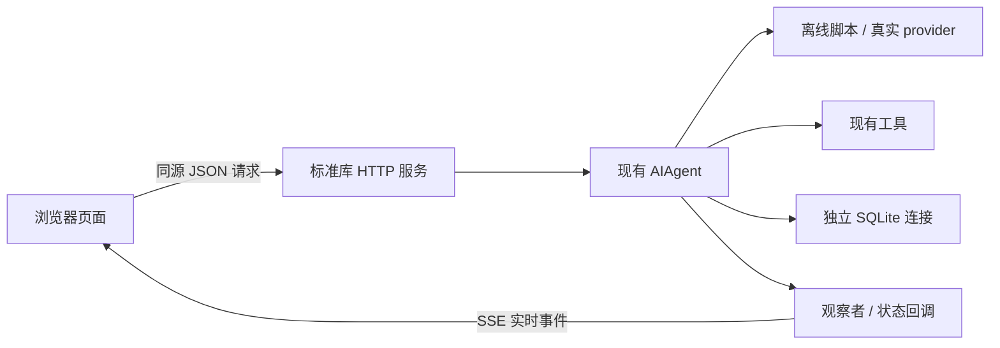
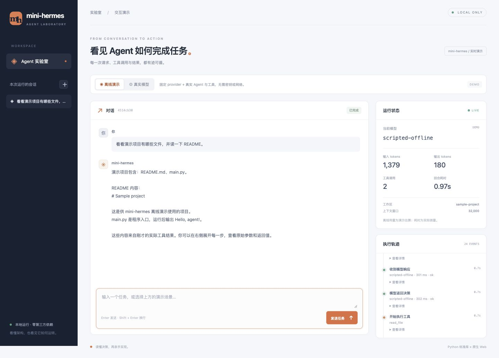

# mini-hermes 演示页面 / Web demo

一个可观察真实 Agent 循环的本地页面，使用 Python 标准库 HTTP 服务与原生 HTML/CSS/JavaScript；无需安装前端工具或 Python 包。

## 启动 / Run

从仓库根运行：

```bash
./mini-hermes/mini --web
```

打开 `http://127.0.0.1:8765`。更换端口：`./mini-hermes/mini --web --web-port 8766`。
按 Ctrl-C 关闭服务；服务只监听本机回环地址。

From the repository root, run the command above and open the local URL. No build or install step is needed. The server binds only to the loopback interface.

## 两种模式 / Modes

| 模式 | 模型决策 | 工具与存储 | 凭据与网络 |
|---|---|---|---|
| 离线演示 | 固定脚本 provider，不理解任意问题 | 真实 Agent 循环、list_dir/read_file；独立临时示例项目与 SQLite 库，退出清理 | 不读取使用者凭据，不发网络请求 |
| 真实模型 | 后端现有 provider/model 配置 | 沿用当前工作区与工具权限；消息写入 `<MINI_HOME>/web/state.db` | 与 CLI 相同，从后端现有配置解析；密钥不传给浏览器 |

离线场景包括浏览项目、读取入口代码、文件不存在；返回内容来自实际工具结果。
离线 tokens 按字符数估算并标注为演示数据；真实模式显示 provider 返回的用量，未返回则为“—”。耗时均实际测量。

Offline mode uses scripted model decisions with real agent and tool execution against temporary fixture files. It does not answer arbitrary questions. Live mode uses your existing backend provider configuration and workspace. API keys stay on the server. Offline token counts are estimates; live usage comes from provider responses.

## 页面能看到什么

- 对话与本次服务运行期间的会话切换；新建会话可以选择离线或真实模式。
- 观察者的模型调用、HTTP 请求、工具开始/完成/拒绝/错误事件，以及参数、结果、耗时。
- Agent 状态回调（例如压缩与回退提示），不伪造额外的压缩事件或模型思维过程。
- 运行模型、输入输出 tokens、工具次数、窗口配置与回合耗时。
- 停止回合；现有审批回调要求确认的危险命令会弹出确认框，未确认或超时则拒绝。

## 边界与实现



SSE（Server-Sent Events，服务器发送事件）让服务端持续推送执行事件。这里通过 POST 的流式响应读取 SSE；模型本身仍按完整响应返回，没有逐 token 输出。

会话列表与 Agent 缓存在内存中，重启后列表清空；真实消息仍保存在独立 Web 数据库中，本版不提供重启恢复入口。每次最多执行一个回合，最多保留 20 个会话，每回合最多 12 次模型迭代。刷新页面会中断原事件连接；可通过停止按钮终止仍在运行的回合。

静态文件采用固定路由；POST 请求校验本机 Host、Origin 与页面令牌，拒绝跨站请求；界面以纯文本渲染用户及工具内容。此服务用于本机演示，不是公网多人服务。

`hermes_cli/web.py` 拥有 Web 生命周期与回合适配，`hermes_cli/web_assets/` 保存静态页面。复用观察者接口，未改 Agent 主循环；SQLite 连接在各工作线程内创建和关闭。

The session list is in memory and resets when the server restarts. Live messages persist in a separate Web database, but this version does not expose restart recovery. One turn runs at a time. The UI streams execution events, not model tokens. This is a local demonstration service.

## 验证 / Validation

运行 `python3 mini-hermes/tests/test_web.py`：覆盖 SSE、真实离线工具、会话与存储隔离、跨站拒绝、审批、中断、断开清理和真实模式的假 provider 验证。测试不读取本机凭据、不调用外部模型。模块位于已有 `hermes_cli` 根白名单内，发布自检会自动覆盖。

浏览器验收覆盖桌面与 390px 手机断点、发送与停止、失败结果、会话切换，以及 HTML 注入文本的安全呈现；无横向溢出，浏览器未报告脚本错误。页面截图见下方。


