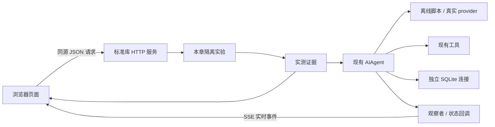
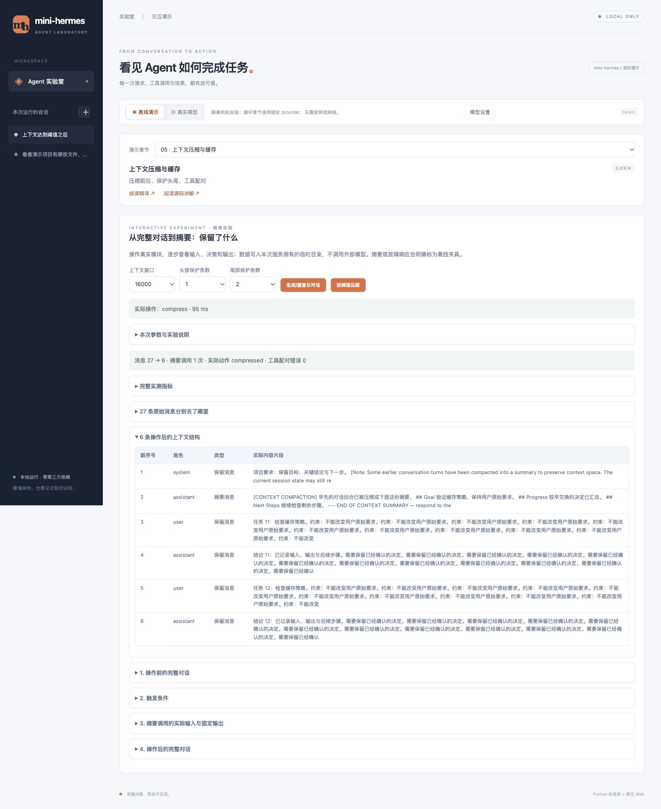
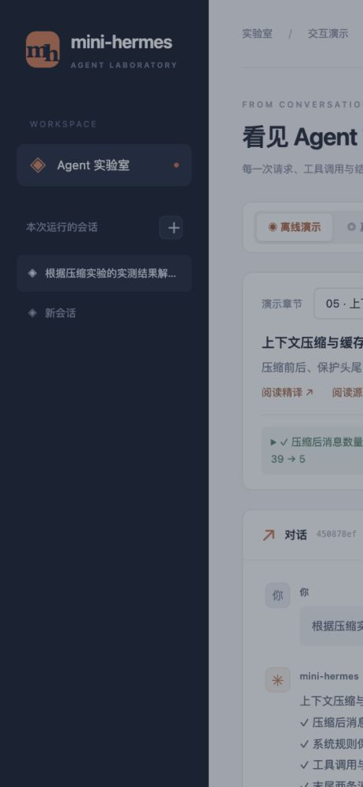

# mini-hermes 演示页面 / Web demo

一个按章节观察机制实验与真实 Agent 循环的本地页面，使用 Python 标准库 HTTP 服务与原生 HTML/CSS/JavaScript；无需安装前端工具或 Python 包。

## 启动 / Run

需要 Python **3.9+**。首次下载与启动（macOS / Linux）：

```bash
git clone https://github.com/ICTQYC/mini-hermes-study.git
cd mini-hermes-study
./mini-hermes/mini --web
```

已下载仓库时，在仓库根目录执行最后一条命令即可。无需安装 Python 包或前端依赖。

打开 [http://127.0.0.1:8765](http://127.0.0.1:8765/)。更换端口：`./mini-hermes/mini --web --web-port 8766`。
按 Ctrl-C 关闭服务；服务只监听本机回环地址。

From the repository root, run the command above and open the local URL. No build or install step is needed. The server binds only to the loopback interface.

## 两种模式 / Modes

| 模式 | 模型决策 | 工具与存储 | 凭据与网络 |
|---|---|---|---|
| 离线演示 | 实验页直接调用对应模块；对话页用固定脚本 provider | 生成隔离夹具、真实执行模块或工具；临时数据退出清理 | 不读取使用者凭据，不发网络请求 |
| 真实模型 | DeepSeek Web 设置优先；未配置则使用后端 provider/model | 对话页直接使用真实 Agent；实验页可先操作实验再提问，附带本次实测片段；工具可读写当前工作区；消息写入 `<MINI_HOME>/web/state.db` | Web 密钥仅在服务内存；其余沿用 CLI 配置 |

机制实验不调用模型，tokens 显示“—”；对话页离线场景的 tokens 按字符数估算。真实模式显示 provider 响应用量，未返回则为“—”。耗时均实际测量。

Offline mechanism experiments invoke actual modules with isolated fixtures. Conversation demos use scripted decisions with real tools. Live conversation pages run the real agent directly. On lab pages, perform an experiment first, then ask the live agent to explain its measured evidence. It can use a DeepSeek key entered in the UI, or existing backend configuration. No credentials are needed for offline demos.

## 按章演示 / Chapter focus

选择章节后，按页面类型操作：

- **当前对话**：点击“运行本章演示”或直接输入任务，再查看每次实际请求、响应及本章详情。
- **互动实验**：调整参数并点击对应操作按钮，在结果面板检查输入、输出和连续操作后的变化。
- **文档导览**：阅读章节说明与 Markdown，不提供运行按钮。

切换章节或模式会新建会话；左侧可返回已有会话，同一次页面打开期间保留该会话的实验控件选择。“阅读精译 / 源码讲解”可打开仓内完整 Markdown 原文。

当前提供 **5 个当前对话查看器**（循环、提示词、存储、技能、观察者）与 **6 个可操作实验**（工具、压缩、Provider、微压缩、状态恢复、引擎）。其余章节只保留文档导览，不伪造运行过程。逐章操作与边界见 [详细演示指南](WEB_CHAPTER_DEMOS.md)。

对话页可回看每次实际请求与响应、工具回填、数据库记录或观察者事件；实验页可修改参数、连续操作，逐步检查实际输入和输出。实验使用独立临时目录；摘要和故障响应明确标为离线夹具，不调用外部模型。真实模式提问时会附带本次实验的实测片段。

## Web 输入 DeepSeek API / Configure DeepSeek

1. 点击“模型设置”，输入 API Key 与账号可用的模型名，保存到内存。
2. 切换“真实模型”，选择章节，运行演示或输入问题。首次发送才实际请求模型并计费；保存不等于连接已验证。
3. 可在设置中清除密钥；Ctrl-C 关闭服务也会清除。刷新浏览器不会清除服务内存，因此页面只显示配置状态、不回显密钥。

Web 密钥不写入 `.env`、浏览器 local/session storage、消息或配置文件；密码框在保存/关闭后清空。回合通过 `get_secret` 的密钥作用域读取它，固定发送至 `https://api.deepseek.com`，不继承自定义端点；已知密钥在模型响应/错误进入核心持久化前替换为 `[REDACTED]`。运行中不能修改设置；更新/清除会使旧的真实 Agent 缓存失效。

模型名可编辑，初始填写 `deepseek-flash`；如账号支持其他型号，可按 [DeepSeek 官方接口文档](https://api-docs.deepseek.com/) 填写。Web 的 DeepSeek 回合显式使用 `thinking: {"type":"disabled"}`，避免未实现的思考内容跨工具回合协议。Web 每回合只使用选定的 provider，禁用自动 fallback；CLI 默认行为不变。

Open **模型设置** (Model settings), enter a DeepSeek API key and model name, save, then select **真实模型** (Live model). Saving does not verify the key or call the API. Calls begin when you send a task and may incur provider charges. Credentials remain in the local server's memory, never in browser storage or credential files; clear them in settings or stop the server. The fixed DeepSeek endpoint and non-thinking mode are used for UI-entered credentials.

## 页面能看到什么

- 对话与本次服务运行期间的会话切换；新建会话可以选择离线或真实模式。
- 观察者的模型调用、HTTP 请求、工具开始/完成/拒绝/错误事件，以及参数、结果、耗时。
- Agent 状态回调（例如压缩与回退提示），不伪造额外的压缩事件或模型思维过程。
- 运行模型、输入输出 tokens、工具次数、窗口配置与回合耗时。
- 停止回合；现有审批回调要求确认的危险命令会弹出确认框，未确认或超时则拒绝。

## 边界与实现



SSE（Server-Sent Events，服务器发送事件）让服务端持续推送执行事件。这里通过 POST 的流式响应读取 SSE；模型本身仍按完整响应返回，没有逐 token 输出。

会话列表与 Agent 缓存在内存中，重启后列表清空；真实消息仍保存在独立 Web 数据库中，本版不提供重启恢复入口。每次最多执行一个回合，最多保留 20 个会话，每回合最多 12 次模型迭代。刷新页面会中断原事件连接；可通过停止按钮终止仍在运行的回合。

静态文件与章节文档采用固定白名单路由；POST 请求校验本机 Host、Origin 与页面令牌，拒绝跨站请求；界面以纯文本渲染用户及工具内容。此服务用于本机演示，不是公网多人服务。

`hermes_cli/web.py` 拥有 Web 生命周期、凭据作用域与回合适配；`hermes_cli/web_lessons.py` 拥有章节目录，`hermes_cli/web_labs.py` 拥有可操作隔离实验，`hermes_cli/web_assets/` 保存静态页面。复用观察者接口；Agent 传输层新增可选 `thinking` 参数，默认不发送，主循环不变。SQLite 连接在各工作线程内创建和关闭。

The session list is in memory and resets when the server restarts. Live messages persist in a separate Web database, but this version does not expose restart recovery. One turn runs at a time. The UI streams execution events, not model tokens. This is a local demonstration service.

## 验证 / Validation

运行 `python3 mini-hermes/tests/test_web.py` 与 `python3 mini-hermes/tests/test_web_lessons.py` 与 `python3 mini-hermes/tests/test_web_chapters.py`：覆盖 SSE、真实离线工具、会话与存储隔离、跨站拒绝、审批、中断、断开清理和真实模式的假 provider 验证。新增测试覆盖全部章节夹具、HTTP 证据、文档白名单、密钥内存生命周期、响应与错误脱敏、官方端点和实际请求体参数。测试不读取本机凭据、不调用外部模型。模块位于已有 `hermes_cli` 根白名单内，发布自检会自动覆盖。

浏览器验收覆盖桌面与 390px 手机断点、发送与停止、失败结果、会话切换，以及 HTML 注入文本的安全呈现；无横向溢出，浏览器未报告脚本错误。章节页与模型设置也以假密钥验证保存、重开不回显及清除；真实外部 DeepSeek 本轮未调用。页面截图见下方。





