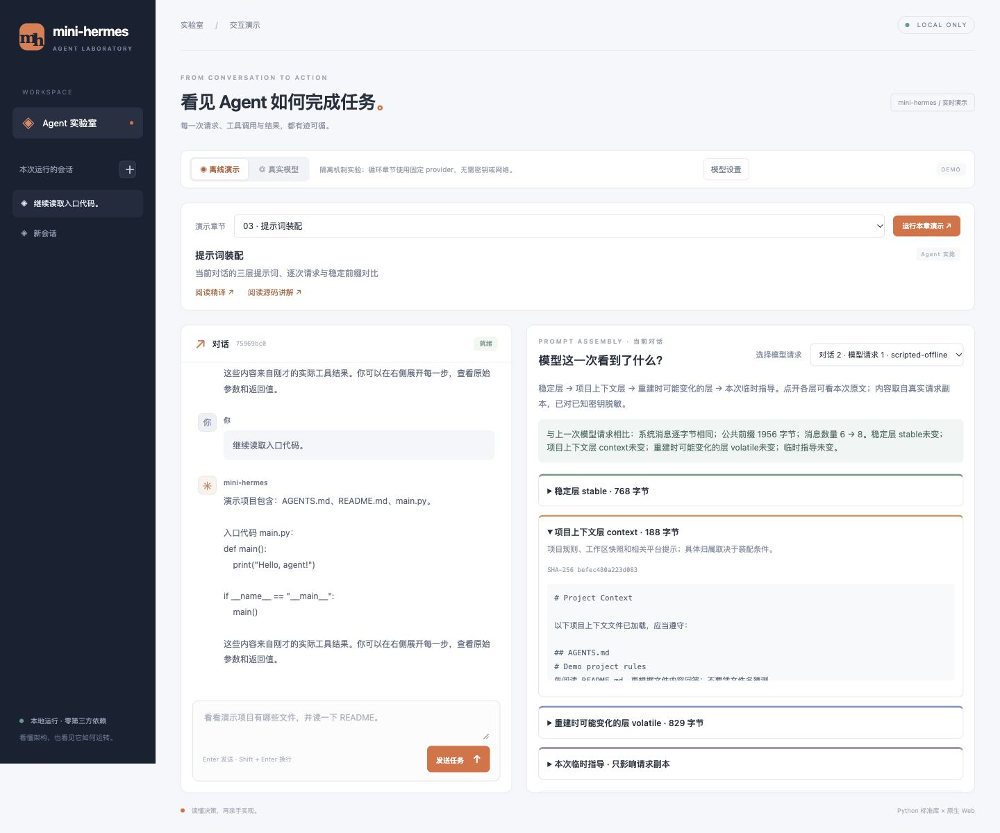

# 在当前对话里观察提示词装配 / Prompt assembly in a conversation

本页对应第 3 章。演示的主体是当前会话实际发送的提示词，不是另跑两次 builder 的自检。
第一章只是架构地图，不提供运行按钮。其他章节已按适用性提供当前对话查看器或可操作实验，见 [逐章演示指南](WEB_CHAPTER_DEMOS.md)。

## 怎么演示

1. 启动 `./mini-hermes/mini --web`，选择“03 · 提示词装配”。
2. 点击“运行本章演示”或发送一条任务。离线场景用固定模型决策，真实执行列目录、读文件；真实模型模式使用同一个查看器。
3. 在右侧选择“对话 1 · 模型请求 1”。展开三层，查看这次的实际内容、字节数和指纹；上下文层默认展开。
4. 依次查看请求 2、3：系统提示词通常相同，但工具调用和结果让 messages 增长。
5. 在同一会话继续追问，再选“对话 2”的请求，查看系统消息、各层、临时指导与上次请求的对比。
6. 展开“完整系统消息”或“完整 messages”，查看交给传输层的实际消息。历史请求保留在本次服务内存中，切换会话后仍可回看。

## 三层分别是什么

| 层 | 本次内容从哪里来 | 为什么这样排 |
|---|---|---|
| stable：稳定层 | 身份、工具指导；没有 git 快照时可能包含平台提示 | 变化少，排在前面保留更多稳定前缀 |
| context：项目上下文层 | 显式系统指令、AGENTS.md 等项目文件、工作区快照及相关提示 | 与项目或工作目录有关 |
| volatile：重建时可能变化的层 | 技能索引、记忆、会话开始时间、运行环境 | 重建时更可能变化，放在后面；正常续聊时它也随整份系统提示词缓存 |

三层之后可能还有临时指导。临时指导只拼进请求副本，不写回历史中的 system 消息。
当前问题和工具结果属于 messages，不属于系统提示词的三层。

离线场景生成独立的 SOUL.md、AGENTS.md、MEMORY.md，方便直接看到各层包含什么。真实模式显示实际工作区和配置产生的内容。

## “稳定”是怎么验证的

装配时保留三层的实际产物，发送请求前读取最终 messages；只有三层拼接确实是当前系统消息的前缀，才显示分层。无法对应时保留实际消息并明确说明，避免重新装配一份不同的提示词来冒充本次请求。

每次请求与前一次比较脱敏副本：系统消息是否相同、各层是否相同、临时指导是否相同、系统消息公共前缀的 UTF-8 字节数、消息数量变化。查看器不截断长提示词后再计算指纹。

正常续聊复用 Agent 上缓存的整份系统提示词，因此时间与记忆不会在每次请求时刷新。压缩后的重建、显式系统指令变化或新会话可能改变内容。这里验证的是本地发出的内容；不能凭字节相同断言服务商已经命中计费缓存。

快照仅保存在本次服务内存，重启清空；已知模型密钥在保存前脱敏。查看器只记录 messages，不将它称为完整 HTTP 请求体。每会话最多 64 次请求、单次 messages 最多 1 MB，达到上限会明确要求新建会话。

## English

Select chapter 03, send a task, then inspect each actual model request in the same conversation. The viewer shows stable, context, and volatile system-prompt tiers, the temporary suffix, and the full messages passed to transport. Continue the conversation to compare byte equality, layer equality, common UTF-8 prefixes, and message growth. Offline decisions are scripted; prompt assembly and tools are real. Live mode uses the same viewer.

Tiers are captured during actual assembly rather than reconstructed later. A prefix check verifies that they match the outgoing system message. Snapshots are redacted, stored only in server memory, and remain available when switching sessions. Local byte stability does not prove provider cache hits. Chapter 01 remains a document-only architecture guide.

