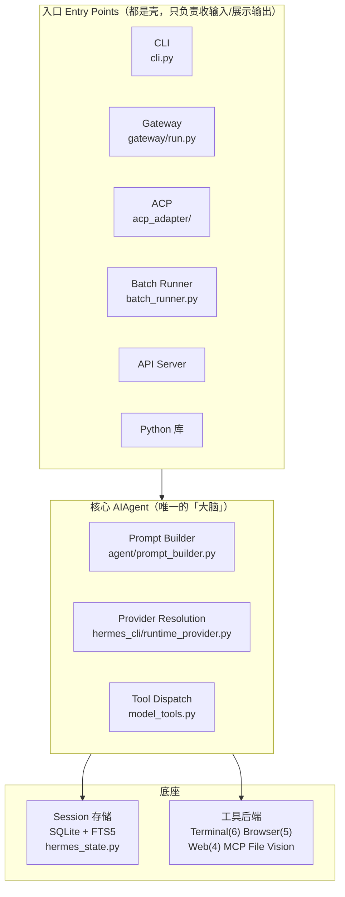

# 中文精译 · 第 1 章：架构总览（Architecture）

> 整合官方 **Developer Guide → Architecture** 页 + 本地源码对照（**本章是精译 + 源码对照合卷**：
> 第 1 章只画地图，没有独立的《源码讲解》与 mini 实现，其源码对照就在下面 §二/§四/§七 里）。
>
> 重点回答三件事：**整个环节用哪个文件、跑哪里的代码、怎么沟通**。
>
> 配套源码：`~/.hermes/hermes-agent/`（git 源码版）。
>
> 📖 和桌面的《Hermes消息完整旅程.md》是**两个互补视角**：那篇是「横切」——一条消息从头到尾跨过所有模块；这篇是「纵切」——每个模块是什么、文件在哪、谁依赖谁。建议先读这篇建立地图，再回那篇看一条消息怎么穿过地图。

[TOC]

---

## 一、全局分三层：壳 → 大脑 → 底座



**这条最关键**：所有入口汇到同一个 `AIAgent`。CLI、网关、ACP、批处理、API server 只是不同的「壳」，唯一区别是**怎么收输入、怎么吐输出**；真正的思考、工具调用、记忆，全在 `run_agent.py` 那一个类里。

这就是设计原则里的 **「platform-agnostic core」（平台无关的核心）**——平台差异活在入口，不在大脑。

---

## 二、文件排布（哪个文件干嘛）

对应本地 `~/.hermes/hermes-agent/`，顶层就这十几样：

```text
hermes-agent/
├── run_agent.py            # ★ AIAgent 核心循环（大文件，一切的中枢）
├── cli.py                  # 终端交互 UI（大文件）
├── model_tools.py          # 工具发现 + 分发
├── toolsets.py             # 工具分组（28 个 toolset 的定义）
├── hermes_state.py         # ★ SQLite 库（state.db 读写全在这）
├── hermes_constants.py     # HERMES_HOME、profile 路径解析
│
├── agent/                  # 大脑内部零件
│   ├── prompt_builder.py   # 系统提示词怎么拼（记忆+技能+上下文）
│   ├── context_engine.py   # 上下文引擎 ABC（可插拔）
│   ├── context_compressor.py  # 压缩（对话太长时总结中间段）
│   ├── prompt_caching.py   # Anthropic prompt 缓存
│   ├── memory_manager.py   # 记忆管理
│   └── anthropic_adapter.py # Anthropic Messages 格式转换
│
├── hermes_cli/             # 所有 `hermes` 子命令的入口
│   ├── main.py             # 入口（hermes chat/setup/model/...）
│   ├── config.py           # 默认配置 DEFAULT_CONFIG
│   ├── commands.py         # ★ 命令注册表 COMMAND_REGISTRY
│   ├── auth.py             # PROVIDER_REGISTRY + 凭证解析
│   ├── runtime_provider.py # provider → api_mode + key + url
│   └── plugins.py          # PluginManager（发现/加载/钩子）
│
├── tools/                  # 工具实现（一个工具一个文件）
│   ├── registry.py         # ★ 中央注册表
│   ├── approval.py         # 危险命令检测
│   ├── terminal_tool.py    # 终端编排
│   ├── process_registry.py # 后台进程管理
│   ├── file_tools.py       # read/write/patch/search
│   ├── web_tools.py        # web_search / web_extract
│   ├── browser_tool.py     # 浏览器自动化
│   ├── code_execution_tool.py # execute_code 沙箱
│   ├── delegate_tool.py    # 子 agent 委派
│   ├── mcp_tool.py         # MCP 客户端
│   └── environments/       # 终端后端（local/docker/ssh/modal/...）
│
├── gateway/                # 消息网关
│   ├── run.py              # GatewayRunner 消息分发
│   ├── session.py          # 会话键 + SessionStore
│   ├── delivery.py         # 投递
│   ├── pairing.py          # DM 配对授权
│   └── hooks.py            # 钩子发现 + 生命周期事件
│
├── plugins/platforms/      # 25+ 平台适配器（telegram/discord/feishu/wecom…）
├── acp_adapter/            # IDE 集成（VS Code/Zed/JetBrains）
├── cron/                   # 调度器（jobs.py / scheduler.py）
├── skills/                 # 内置技能（始终可用）
├── optional-skills/        # 可选技能（显式安装）
└── tests/                  # ~25,000 测试 / ~1,250 文件
```

带 ★ 的是「枢纽文件」，理解架构时最先看这几个：**run_agent.py、hermes_state.py、commands.py、registry.py、runtime_provider.py**。

### 2.1 枢纽文件详解

这 5 个之所以是「枢纽」，因为它们是**大脑和底座的关节**。逐个看：

#### ① run_agent.py — 唯一的大脑本体

`AIAgent` 类，一切的中枢。职责清单（对应官方 `agent-loop.md`）：

- 拼系统提示词 + 工具 schema（经 `prompt_builder.py`）
- 选 provider / API 模式（`chat_completions` / `codex_responses` / `anthropic_messages` 三选一）
- 发起**可中断**的模型调用（支持取消）
- 执行工具调用（线程池并发或串行）
- 维护对话历史（OpenAI message 格式）
- 压缩 / 重试 / fallback 换模型
- 迭代预算管理（父/子 agent 共享）
- 上下文丢失前 flush 持久记忆

关键点：两个入口——`agent.chat()` 是 `run_conversation()` 的薄包装，只返回最终回复字符串；`run_conversation()` 返回完整 dict（messages / metadata / usage）。**所有壳（CLI/网关/cron/ACP）最后都汇到 `run_conversation()`**，这就是「壳不同、核一样」的物理落点。

#### ② hermes_state.py — 底座的唯一数据库

`~/.hermes/state.db` 的所有读写都在这。管的是一整套表（对应官方 `session-storage.md`）：

- `sessions` — 会话元数据、token 计数、billing
- `messages` — 完整消息历史
- `session_model_usage` — 按模型/任务的用量归属
- `messages_fts` / `messages_fts_trigram` / `messages_fts_cjk` — 三张 FTS5 全文索引（各绑一个分词器，见下）
- `state_meta`、`gateway_routing`、`compression_locks`、`async_delegations`、`schema_version`

关键点：**WAL 模式**（网关多平台要并发读 + 一个写）；靠 `parent_session_id` 链实现「压缩触发的会话分裂」（compression-triggered splits）。

**FTS5 = SQLite 内置的全文搜索引擎（Full-Text Search v5）**

**为什么三张 FTS5 表（分词器决定切法）**

FTS5 是 SQLite 内置的全文搜索引擎，靠倒排索引做关键词匹配，比 `LIKE '%x%'` 快几个数量级。全文搜索第一步是「分词」（tokenize）——把文本切成一个个「词」再建索引，而**一张 FTS5 表只能绑一个分词器（tokenizer）**，所以 Hermes 为三种需求建了三张并行表：

| 表 | 分词器 | 切法（例：`智能计算系统很有意思`） | 定位 |
|---|---|---|---|
| `messages_fts` | unicode61（默认） | 英文按空格切 `the / quick / fox`；中文无空格 → 整串当 1 个 token | 主索引，英文友好 |
| `messages_fts_trigram` | trigram | 每 3 字一组：`智能计 / 能计算 / 计算系 / …` | 任意语言子串搜索，但查询词须 ≥3 字 |
| `messages_fts_cjk` | cjk_unicode61（自定义） | 每 2 字一组：`智能 / 能计 / 计算 / 算系 / …` | 补 trigram 盲区：中文/韩文 1–2 字词 |

关键：trigram 要求查询词 ≥3 字符，而中文里 1–2 字词极常见（`项目`、`일본`），会退化成慢速 LIKE 全表扫描（多 GB 库实测 3–6 秒/查询）。于是 Hermes 自己写了个 ~250 行的 `cjk_unicode61` 分词器（编译成 `~/.hermes/lib/libfts5_cjk.so`，Lucene CJKAnalyzer 语义）：把连续 CJK 串切成重叠的二字组，让「最短 2 字」的精确子串匹配也能走索引速度。

你平时 `session_search` 搜中文，底层就是这几张表配合：先走 cjk/trigram 索引，搜不到再退到 LIKE。

#### ③ commands.py — CLI 的命令注册表

`COMMAND_REGISTRY` 这张表决定 `hermes` 后面能跟哪些子命令。加一条命令 = 往注册表 register 一个条目 + 在 `hermes_cli/main.py` 接线。理解它就能看懂「`hermes gateway` / `hermes cron` / `hermes model`」其实是同一套注册机制挂上去的兄弟命令。

> ⚠️ 官方没有单独的 commands.py 详解：`extending-the-cli.md` 讲的是 TUI 扩展钩子（加 widget / 快捷键 / 斜杠命令），跟「子命令怎么注册」相关但不同。这块要靠读源码补。

#### ④ registry.py — 工具系统的中央注册表

整个框架最巧妙的自举设计。每个 `tools/*.py` 在 **import 时**就调 `registry.register(name, toolset, schema, handler, check_fn, ...)` 把自己登记进单例 `ToolRegistry._tools` 字典。`discover_builtin_tools()` 用 **AST 解析**扫 `tools/` 目录、找所有顶层有 `register()` 调用的文件再 import 它们——所以加新工具 = 丢一个文件进去 register 一下，**别的地方一行都不用改**（这就是第四节依赖链图的含义）。

**AST 解析是什么**

AST = Abstract Syntax Tree（抽象语法树）：把源码文本解析成一棵树，每个节点是一个语法单元。「抽象」= 丢掉空格/注释/括号，只留语义结构。`registry.register(name="terminal", handler=f)` 经 `ast.parse` 后长这样：

```
Expr（表达式语句）
└── Call（函数调用）
    ├── func: Attribute
    │   ├── value: Name(id="registry")   ← 是 registry 这个对象
    │   └── attr: "register"             ← 调 .register 方法
    ├── keyword: name="terminal"
    └── keyword: handler=f
```

为什么用 AST 而非「直接 import 所有文件」：import 会真的执行代码（副作用/依赖/慢），AST 是「静态读一遍」、只挑真正注册了工具的再 import。判断函数 `_is_registry_register_call` 在树上走三层 `Expr → Call → func`，确认 `func.attr == "register"` 且 `func.value.id == "registry"`——所以 `foo.register(...)` 或注释里的 `register(` 都不会误命中（正则做不到）。

两个实现巧思：① **便宜文本预过滤**——源码里同时没有 "registry" 和 "register" 两词就直接跳过，省掉 `ast.parse` 开销；② 只查 `tree.body`（模块顶层语句），「在函数内部才调 register」的辅助模块不会被误选。扫描结果按 `(mtime_ns, size)` 缓存磁盘（100 文件约 145ms，不值得每次重扫）。

**这个设计 vs 其他框架的优劣**

三件套：import 即注册（副作用式）+ AST 静态发现（只读不执行）+ 单例注册表（全局查询）。对比其他做法：

| 做法 | 代表 | 加一个工具改几处 |
|---|---|---|
| 手动清单 | 自研框架常见 | 2 处（写工具 + 改中央清单） |
| 装饰器 + 显式 import | LangChain `@tool` | 2 处（写工具 + import 进调用点） |
| 原生 function calling | OpenAI 原始用法 | N 处（每个工具手写 schema + 组装） |
| **自注册 + AST 发现** | **Hermes** | **1 处（只写工具文件）** |

优点：① 去中心化——无中央清单，加工具零改动调用点，并行贡献不抢文件；② 一工具一文件，review/test/blame 清晰；③ AST 静态发现只读不执行，避免 import 副作用；④ 注册与使用解耦 + 用 `check_fn`（按需可用）/ `override`（防冲突）治理全局单例。

代价（诚实版）：① import 副作用——依赖模块顶层执行，非「纯」函数式；② 全局单例可变状态，测试隔离要额外治理；③ 约定优于配置——依赖「顶层 register」约定，函数内 register 会被故意排除。

适合场景：工具多、频繁增删、插件也能贡献工具（Hermes 28 个 toolset + 插件/MCP），用「一次性发现机制复杂度」换「长期维护成本」。若只有 3 个工具且不增删，手动清单反而更直白。

**清单 vs 注册表（答疑）**

「清单」和「注册表」数据结构几乎一样（都是 `名字 → 工具` 的 dict）。区别在**谁往里填**：清单是**你手动**把每个工具填进去（改中央文件），注册表是**工具自己**在 import 时 register 进去（容器只被动接收 + 提供查询）。所以准确说 Hermes 不是「没有清单」，而是「清单自动化了」——`ToolRegistry._tools` 就是它的清单，但没人手写它。

**你自己加一个工具，差多少？**

手动清单式：写 `my_tool.py` → 还要去中央文件 `import` + `append` + 加 schema（2–4 处，且要**记得**去改）。自注册式：只写 `my_tool.py` 顶层 `registry.register(...)`（1 处，结束）。加 **1 个**工具时差别就一两行、体感不大；差别在规模化才放大——① 多人并行：两人都去改中央文件同一行 → git 冲突，自注册各写各的互不干扰；② 插件/MCP 也能贡献工具：第三方模块 import 时自动进注册表，手动清单做不到；③ 删/禁用工具：自注册用 `check_fn` 返回 False 即可，不动注册表。

一句话：它省的不是写代码量，是「人肉同步清单」这个易错环节；为的是「多来源 + 多人 + 频繁增删」。你个人加 1 个工具，手动清单真不差多少。

#### ⑤ runtime_provider.py — provider → api_mode + key + url

你选「deepseek」这个 provider，它负责翻译成「用 `chat_completions` 模式、base_url 是多少、key 从哪个环境变量拿、fallback 换谁」。解析优先级严格：**显式请求 > config.yaml > 环境变量 > 默认值**。这条顺序很关键——官方特意强调，就是为了防止残留的 shell 环境变量悄悄覆盖你在 `hermes model` 里最后选的那个模型。它跟 `auth.py`（`PROVIDER_REGISTRY` 存 provider 名单）是一对：auth 管「有哪些 provider」，runtime_provider 管「选中之后怎么落地」。

**「落地」到底指什么**

「落地」= resolve。把抽象的「用哪个 provider」翻译成一次 API 请求的**完整参数包**，官方列的 resolve 输出：`provider`、`api_mode`、`base_url`、`api_key`、`source`（+ token 过期/刷新等元数据）。所以不只是「选 provider」，而是把「用哪个 provider、走哪套协议（`chat_completions` / `codex_responses` / `anthropic_messages`）、打哪个 URL、用哪把 key」一起定死——同一 provider 也可能对应不同 api_mode（openai→chat_completions，openai-codex→codex_responses，anthropic→anthropic_messages 原生）。

**优先级四层怎么走**

核心逻辑「越明确、越当下越优先」：

1. 显式请求（`--provider` / `--model` 命令行参数、代码显式传参）
2. config.yaml（`hermes model` 保存的持久选择）
3. 环境变量（`OPENAI_API_KEY` 等 shell 残留）
4. provider 默认 / 自动解析（兜底：如看 base_url host 猜 api_mode）

为什么 config 压过 env：防止 stale 的 shell export 悄悄覆盖你在 `hermes model` 最后选的端点。例：你选了 deepseek（存进 config），但 shell 里残留一个旧 `OPENAI_API_KEY`——若 env 优先，这个残留 key 会把请求偷偷劫持到 OpenAI；所以 config（你明确保存的）> env（可能残留），只有 `--provider` 这种「当场明确」的才最优先。

**一句话串起来**：run_agent（大脑）→ 问 runtime_provider（用哪个模型）→ 拼提示词 → 通过 registry 派发工具 → 把结果写进 hermes_state（底座）；commands 站在最外面决定「你用什么姿势进来」。

---

## 三、数据流（跑哪里的代码）—— 三条线

同一条链路，三种入口各走一遍。注意中间段完全一样。

### ① CLI 会话（你现在正在用的）

```text
用户输入 → HermesCLI.process_input()                [cli.py]
  → AIAgent.run_conversation()                       [run_agent.py]
    → prompt_builder.build_system_prompt()           [agent/prompt_builder.py]
    → runtime_provider.resolve_runtime_provider()    [hermes_cli/runtime_provider.py]
    → API 调用（chat_completions / codex_responses / anthropic_messages）
    → 有工具调用？→ model_tools.handle_function_call() → 循环
    → 最终回复 → 显示 → 写 SessionDB                  [hermes_state.py]
```

### ② 网关消息（接 Telegram/飞书时）

```text
平台事件 → Adapter.on_message() → MessageEvent       [plugins/platforms/xxx]
  → GatewayRunner._handle_message()                  [gateway/run.py]
    → 授权（五层）
    → 解析会话键
    → 带着会话历史创建 AIAgent
    → AIAgent.run_conversation()                     [run_agent.py]
    → 经适配器把回复投递回去                         [gateway/delivery.py]
```

### ③ 定时任务（cron）

```text
调度器 tick → 从 jobs.json 加载到期任务              [cron/scheduler.py]
  → 创建全新 AIAgent（无历史）
  → 注入附加技能作为上下文
  → 跑任务 prompt
  → 投递到目标平台
  → 更新任务状态 + next_run
```

**规律：三条线的中间段（`AIAgent.run_conversation()`）完全一样，差别只在头尾。**

| 线 | 头（收输入） | 尾（吐输出） |
|---|---|---|
| CLI | 键盘 | 终端显示 |
| 网关 | 平台适配器 | 投递（delivery） |
| cron | 调度器 | 投递（delivery） |

这就是「壳不同、核一样」。

---

## 四、组件怎么沟通：文件依赖链

官方给的「谁 import 谁」图，解释了工具系统怎么自举：

```text
tools/registry.py        （零依赖，被所有工具文件 import）
       ↑
tools/*.py               （import 时调用 registry.register()）
       ↑
model_tools.py           （import registry + 触发工具发现）
       ↑
run_agent.py, cli.py, batch_runner.py, environments/
```

**含义：工具注册发生在 import 时，早于任何 agent 实例创建。**

所以 `tools/` 里任何带顶层 `registry.register()` 的 `.py` 文件都会被**自动发现**——不需要手写导入清单。你想加一个新工具，就是往 `tools/` 丢一个文件、在里面 register 一下，别的什么都不用改。

### 4.1 术语辨析：钩子 vs 注册表 vs 回调

笔记里反复出现三个词，容易混，先厘清：

| 词 | 本质 | Hermes 例子 |
|---|---|---|
| **钩子（hook）** | 框架在流程的**固定位置**预留「挂载点」，允许外部插入逻辑而不改框架；不挂也照跑 | `gateway/hooks.py`（生命周期事件）、`plugins.py` 的 PluginManager 钩子、`extending-the-cli` 的 5 个扩展方法（override = 挂载） |
| **注册表（registry）** | 一张「清单」，登记「有哪些东西可用」，框架**查表**取用 | `tools/registry.py`、`commands.py` 的 COMMAND_REGISTRY、`auth.py` 的 PROVIDER_REGISTRY |
| **回调（callback）** | 你主动**传一个函数**给框架，「轮到我了叫我」 | `registry.register(..., check_fn=...)`、`handler=...` |

一句话：**钩子是「流程里的插入点」，注册表是「数据清单」，回调是「你塞给框架的那个函数」**。三者常组合出现——框架走流程时先查注册表拿到清单，在钩子点调用你注册的回调。

---

## 五、设计原则（6 条）

| 原则 | 含义 |
|---|---|
| **Prompt stability** | 系统提示词中途不变，除 `/model` 外不击穿缓存 |
| **Observable execution** | 每次工具调用都可见（CLI spinner / 网关消息） |
| **Interruptible** | API 调用和工具执行可中途取消 |
| **Platform-agnostic core** | 一个 AIAgent 服务所有入口 |
| **Loose coupling** | MCP/插件/记忆 provider 用注册表 + check_fn，不强依赖 |
| **Profile isolation** | 每个 profile 独立的 HERMES_HOME、配置、记忆、会话 |

---

## 六、官方推荐阅读顺序

想深入某块，按官方给的顺序读：

| # | 文档 | 讲什么 |
|---|---|---|
| 1 | **Architecture**（本篇） | 顶层地图，先建立全局观 |
| 2 | Agent Loop Internals | AIAgent 怎么跑 |
| 3 | Prompt Assembly | 系统提示词怎么拼 |
| 4 | Provider Runtime | provider 怎么解析 |
| 5 | Adding Providers | 手把手加新 provider |
| 6 | Tools Runtime | 工具注册表、分发、后端 |
| 7 | Session Storage | SQLite schema、FTS5 |
| 8 | Gateway Internals | 消息网关 |
| 9 | Context Compression & Caching | 压缩 + prompt 缓存 |
| 10 | ACP Internals | IDE 集成 |

> 完整索引：`https://hermes-agent.nousresearch.com/docs/llms.txt`

---

## 七、实战验证：桌面 App 背后是什么

> 这一节来自实际答疑，把「入口」这个话题补全——桌面 App 这个入口，官方架构图里没单独画，但它是最常用的一个。

### 7.1 技术栈：Electron + React

| 技术 | 是什么 | 类比 |
|---|---|---|
| **Electron** | 用网页技术（HTML/CSS/JS）写桌面软件的框架，内置 Chromium + Node.js | 房子（壳） |
| **React** | 写界面的 JavaScript 库，界面拆成组件，数据变界面自动刷新 | 家具装修（内容） |

所以 Hermes 桌面 App 本质是「一个被包成桌面软件的网页」——这也是它能一套代码跑 macOS/Windows/Linux 的原因（网页技术天生跨平台）。

### 7.2 命令辨析：serve ≠ --continue ≠ cli.py

`hermes --help` 里能看到：`--continue` 是主命令的 **flag**，`serve` 是独立的**子命令**。

```text
hermes --continue  → 跑 cli.py（终端壳），终端交互，聊完退出
hermes serve       → 跑后端服务进程（不是 cli.py），监听端口，常驻
hermes desktop/gui → 启动桌面 App（自动拉起一个 serve 后端）
```

| | `hermes` / `--continue` | `hermes serve` |
|---|---|---|
| 跑的是 | **cli.py**（终端壳） | 后端网关进程 |
| 有无界面 | 有（终端交互） | 无（纯后台服务） |
| 生命周期 | 启动→聊→退出 | 启动→常驻→直到 stop |

两者都汇到同一个 AIAgent，但互不相干。

### 7.3 网关怎么工作（daemon）

网关 = **常驻守护进程（daemon）**。`gateway start` 的「start」= 启动这个 daemon，通常配 systemd/launchctl/tmux 保活。

工作循环（进程视角）：

```text
① 启动(start) → 加载平台适配器
② 连接        → 适配器连上各自渠道（Telegram 长轮询 / 飞书 WebSocket / 本地端口）
③ 常驻监听    → 什么都不做，等消息进来
④ 收到消息    → 翻译 → 授权 → 路由 → 交 AIAgent → 回发
⑤ 回到 ③     → 继续监听，永不退出（除非 stop/崩溃）
```

| | CLI（`hermes`） | 网关（`hermes gateway`/`serve`） |
|---|---|---|
| 生命周期 | 启动 → 聊 → **退出** | 启动 → **常驻** → 直到 stop |
| 输入来源 | 键盘（stdin） | 网络端口 / 平台 push |
| 谁等谁 | 它**等你**打字 | 它**监听**，消息主动进来 |

一句话：网关是个 24 小时坐着的前台，从各渠道接电话、问清身份、转接 AI 大脑、再把回话转回。

> 和 OpenClaw 的关系：`openclaw gateway start` ≈ `hermes gateway start`，同一个概念。这类 Agent 框架（OpenClaw / Claude Code / Codex / Hermes）网关设计大同小异，都是「让一个 AI 大脑被多个渠道访问」。

### 7.4 实锤：查你自己机器上的进程

打开桌面 App 时，后台确实有个 serve 进程在跑（`ps` 实测）：

```text
python -m hermes_cli.main serve --host 127.0.0.1 --port 0
```

用 `lsof` 能看到它实际监听的端口（示例，实际值每次随机）：

```text
python3.1  951  TCP 127.0.0.1:49468 (LISTEN)
```

| 参数 | 含义 |
|---|---|
| `--host 127.0.0.1` | 只监听本机回环，外网连不上（默认安全） |
| `--port 0` | 端口随机分配，App 内部知道连哪个 |

> 注意它跑的是 `hermes_cli/main.py` 的 **`serve` 子命令**，不是 `cli.py`。

同一时刻 `ps` 还能看到完整的 App 进程结构，正好把 7.1 的技术栈对上号：

```text
Hermes                                pid 686   ← Electron 主进程
Hermes Helper (Renderer)              pid 15516 ← React 界面（Chromium renderer）
Hermes Helper --type=gpu-process      pid 735   ← 渲染加速
Hermes Helper --type=utility(...)     若干      ← 网络/音频等子进程
python -m hermes_cli.main serve       pid 951   ← hermes serve 后端
```

（上面 pid 是某次实测快照，每次启动都会变；但进程种类是固定的。）

完整链路：

```text
你打字/点击
   ↓
Electron 主进程
   ↓
React renderer（你看到的界面）
   ↓ WebSocket 连 127.0.0.1:<随机端口>
hermes serve 后端（监听本机端口）
   ↓
AIAgent（同一个大脑）
```

一个细节：serve 进程由 App 启动时拉起、常驻，活得比单个聊天窗口还久——又印证了「网关是常驻进程」。

---

## 附录：和《Hermes消息完整旅程.md》怎么对照着看

| | 《架构总览》（本篇） | 《消息完整旅程》 |
|---|---|---|
| 视角 | **纵切**：每个模块是啥、文件在哪、谁依赖谁 | **横切**：一条消息从头到尾穿过所有模块 |
| 核心图 | 壳→大脑→底座 + 文件依赖链 | 七阶段流程图（适配器→守卫→…→投递） |
| 适合回答 | 「这个功能在哪个文件？」 | 「这条消息走过了什么？」 |
| 交叉点 | 数据流③条线 ≈ 旅程的骨架 | 旅程的 5/6/7 节对应数据流的中间段 |

**建议读法**：先看本篇第一节（分层）和第四节（依赖链）建立坐标 → 再看《消息完整旅程》理解一条消息怎么在这个坐标里移动 → 最后回到本篇第三节（数据流）把两条线对起来。

两条设计公理（来自源码 `AGENTS.md`，理解一切的钥匙）：

> 1. **Per-conversation prompt caching is sacred**（每轮对话的 prompt 缓存是神圣的）——除压缩外，绝不在对话中途改动上下文。
>
> 2. **The core is a narrow waist; capability lives at the edges**（核心是窄腰，能力长在边缘）——新能力优先走 skill/plugin/MCP，最后才加核心工具。
