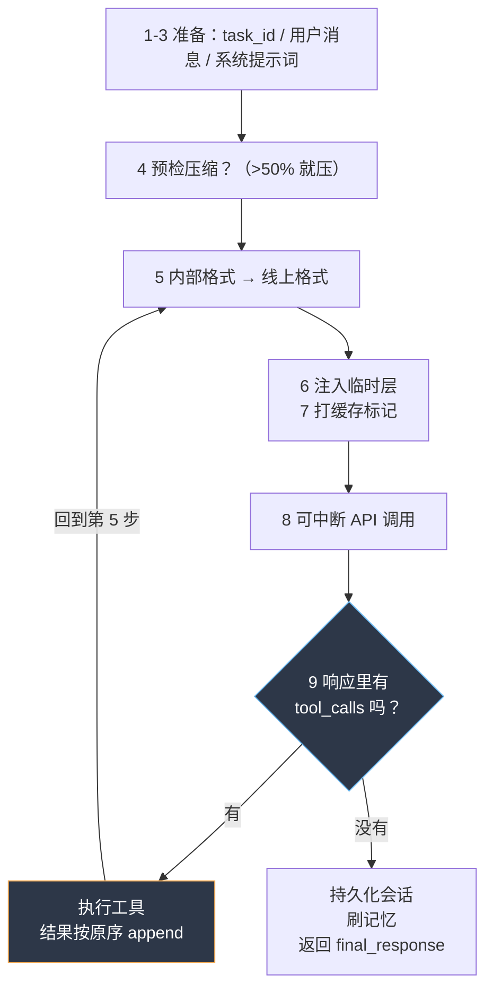

# 中文精译 · 第 2 章：Agent 循环内部（Agent Loop Internals）

> 维护说明：章节交付时的统计与实测输出保留原口径；当前发布前修复、套件数字与验证收据见《发布前修复记录.md》。mini 代码引用按维护后的实现核对。

> 原文：`官方文档-Developer-Guide/agent-loop.md`
> 源码对照：`~/.hermes/hermes-agent/`
> 对应实现：`mini-hermes/run_agent.py`（本目录下）
>
> 读法：**粗体黑字是原文的意思，`【源码】`块是真实 Hermes 里长什么样，`【动手】`块是我们 mini 版怎么做的。**
> 最后一节是"我砍掉了什么、砍掉会失去什么"——这才是看文档看不出、必须自己写一遍才知道的部分。

> mini 当前维护说明见对应《源码讲解》的“发布前维护”节；原文翻译与历史实测不代替当前实现契约。

[TOC]

---

## 0. 这一章在整张地图上的位置

上一章（架构总览）说了：所有入口（CLI / 网关 / ACP / Python 库）都汇到同一个 `AIAgent`。

这一章讲的就是**那个 `AIAgent` 里面到底在干嘛**。

一句话概括：**AIAgent 是一个 `while` 循环 + 一堆管家活**。
"循环"本身简单到 20 行就能写完；文档 239 行里 90% 的内容，都是在讲
"循环每一圈要处理的那些意外情况"——中断、超预算、工具并发、模型挂了、上下文满了。

> 💡 这是看架构文档最容易踩的坑：以为难点在 `while True` 里。
> 等你真的自己写一遍就会发现，**难点全在 `while True` 外面**。

---

## 1. 核心职责（Core Responsibilities）

**原文说 `AIAgent` 负责这几件事：**

- 通过 `prompt_builder.py` 拼装最终生效的系统提示词和工具 schema
- 选择正确的 provider / API 模式（`chat_completions`、`codex_responses`、`anthropic_messages`）
- 发起**可中断**的模型调用，支持取消
- 执行工具调用（串行，或通过线程池并发）
- 用 OpenAI 消息格式维护对话历史
- 处理压缩、重试、以及回退模型切换
- 跟踪父 agent 和子 agent 的迭代预算
- 在上下文丢失之前把持久记忆刷到磁盘

`【源码】` `run_agent.py` 1560 行，是个 **facade**；真正的 loop 拆在 `agent/` 下 30 个 `turn_*.py` 兄弟模块里：

ps：facade = 门面。 设计模式里的原意：一个薄的前台，背后藏着一堆零件。它自己不算账、不做菜，只负责接客和转发——酒店前台、医院导诊台就是这个意思。它是"别人 import 的那个名字"

不管里面被拆成多少文件，下面这行永远能用：

```
from run_agent import AIAgent
```

这是关键。Hermes 有 5 个入口（CLI / 网关 / ACP / 批处理 / Python 库）都在 import 这个名字。只要 facade 不动，内部怎么重构都伤不到调用方。

| 兄弟模块 | 负责的动作 |
|---|---|
| `agent/turn_iteration_prep.py` | 每圈开始前的准备 |
| `agent/turn_request_assembly.py` | 组装这一轮要发的请求 |
| `agent/turn_api_call.py` / `turn_api_error.py` | 发请求 / 处理错误 |
| `agent/turn_response_intake.py` / `turn_response_check.py` | 接响应 / 校验响应 |
| `agent/turn_tool_round.py` / `turn_tool_validation.py` | 工具这一轮 |
| `agent/turn_finalizer.py` / `turn_final_response.py` | 收尾 |
| `agent/iteration_budget.py` | 迭代预算 |

`【动手】` 我们不拆文件（拆了你也看不出好处），但**每一段都加了编号注释**，
编号和下面第 4 节的 9 步 turn lifecycle 一一对应。等你哪天觉得 `run_agent.py` 太长了，
就知道 Hermes 为什么要拆成 `turn_*.py`。

---

## 2. 两个入口（Two Entry Points）

**`AIAgent` 对外只开两个门：**

```python
# 简单接口 —— 只要最终答复字符串
response = agent.chat("Fix the bug in main.py")

# 完整接口 —— 返回 dict：messages / metadata / usage 统计
result = agent.run_conversation(
    user_message="Fix the bug in main.py",
    system_message=None,            # 不传就自动构建
    conversation_history=None,      # 不传就从 session 自动加载
    task_id="task_abc123"
)
```

**`chat()` 只是 `run_conversation()` 外面套的一层薄壳，把结果 dict 里的 `final_response` 抠出来。**

`【源码】` 这个设计的用途是：**CLI 只要字符串，网关/批处理要全部元数据**。
两个入口 = 一个核心，两种粒度，不需要写两套逻辑。

`【动手】` `run_agent.py` 的 `chat()` 就 1 行：

```python
def chat(self, user_message: str) -> str:
    return self.run_conversation(user_message)["final_response"]
```

> ⚠️ 一条纪律：**薄壳里不要加 agent 行为的逻辑**。
>
> 注意这个限定词，它很重要（我第一版写的是"薄壳里不要加逻辑"，那是**错的**——见本节末尾的更正）。
>
> 判定问题（直接想场景，不用先理解术语）：
>
> **"我现在是在终端里用它。如果改成从手机上使唤它，这件事还需要吗？"**
>
> - "把工具进度画成一行彩色文字" → 手机上不要彩色也不要那行字 → **壳的事**
> - "这条命令危险，得先问用户" → 手机上照样得问 → **核心的事**
>
> **最容易判错的例子：Ctrl-C 打断**
>
> - "接住 Ctrl-C 这个按键" → 只有终端有键盘 → **壳**
> - "被打断时把半截响应丢掉、绝不许写进对话历史" → 手机上打断也一样 → **核心**
>
> 同一个功能，一半在壳、一半在核心。**所以这条规则不是给"功能"分类，是给"行为"分类**——
> 一个功能里往往既有壳的部分又有核心的部分，要拆开看。
>
> 落在这条线上的具体动作：哪天你想在 `chat()` 里"顺便处理一下"，就该改 `run_conversation()`。
> 因为**真实调用点全在 `run_conversation()` 那边**（实测 20 多处：`batch_runner.py`、网关、ACP、eval），
> 而 `AIAgent.chat()` 在仓库里（测试/eval 之外）**没有调用点**。所以这条纪律防的主要是**未来**
> 和**外部库用户**（`teaching: programmatic-integration.md` 就是给他们的），
> 不是"现在正在出 bug"。

<details>
<summary>📖 术语：Hermes 文档里的 "surface"</summary>


指**用户接触 agent 的那个入口**。每多接一个平台就多一个"面"：

```text
CLI（终端）   桌面 App    TUI        网关（Telegram/Discord/Slack…）   IDE（VS Code/Zed，走 ACP）
```

官方文档里到处出现这个词（`hermes-agent` skill 里就有一节叫 *Surfaces*），所以后面章节还会遇到。
但它**不是需要专门记住的概念**，就是"入口"的同义词。

<details>
<summary>📌 更正记录：我第一版把这条写成了"薄壳里不要加逻辑"</summary>

两个地方写过头了，实测数据：

| 我原来的说法 | 实测 |
|---|---|
| "薄壳里不要加逻辑" | `agent/turn_facade.py` 的 `run_conversation()` 有 **178 行、25 条语句**——turn 准入、跨进程会话租约、记账作用域、liveness 看门狗，全是真逻辑 |
| "整个 CLI 没有一行决策逻辑" | `cli.py` **4689 行、220 个函数**，外加 12 个 `hermes_cli/cli_*_mixin.py` |

**结论修正**：不是"壳里不能有逻辑"，而是"**壳里不能有 agent 行为的逻辑**"。
壳里该有的是：渲染什么、怎么收输入、这个平台的怪癖怎么绕。
壳里不该有的是：什么情况下该做什么决定。
</details>
</details>

---

## 3. API 模式（API Modes）

**Hermes 支持三种 API 执行模式**，由 provider 选择、显式参数、base URL 启发式共同决定：

| API 模式 | 用于 | 客户端 |
|---|---|---|
| `chat_completions` | OpenAI 兼容端点（OpenRouter、自定义、大多数 provider） | `openai.OpenAI` |
| `codex_responses` | OpenAI Codex / Responses API | `openai.OpenAI`（Responses 格式） |
| `anthropic_messages` | Anthropic 原生 Messages API | `anthropic.Anthropic`（经适配器） |

**模式决定了：消息怎么格式化、工具调用怎么结构化、响应怎么解析、缓存/流式怎么做。**
三种模式在 API 调用**前后**都会收敛到同一套内部消息格式（OpenAI 风格的 `role`/`content`/`tool_calls` dict）。

**模式解析优先级（从高到低）：**
1. host 强制协议（例如 Anthropic 主机要求 `anthropic_messages`，防止错配）
2. 允许的显式 `api_mode` 覆盖
3. URL 检测与 provider 画像声明
4. 默认：`chat_completions`

这是源码核对后的顺序；上游概述不应理解成显式模式可以绕过 host 约束。详见第 8 章。

`【源码】` 关键点在于**收敛**：内部永远只用 OpenAI 格式，**只在一条边界上做翻译**——

- **发请求之前**：把内部格式转成"这家 API 要的格式"
- **收到响应之后**：把"这家 API 返回的格式"转回内部格式

用一条水平线想它就清楚了：

```text
        内部（agent 全程只说这一种话：OpenAI 格式）
────────────────────────────────────────────────────────  ← 边界：只有这里要翻译
   chat_completions      codex_responses      anthropic_messages        gemini_native …
   （各家 API 的方言）
```

**为什么这条边界必须存在**：看一个真实例子——同一句"我要调用 read_file，然后拿到了结果"，
两种格式长得完全不一样：

```python
# ① 内部格式（agent 从头到尾只用这个）
{"role": "assistant", "content": "", "tool_calls": [
    {"id": "call_1", "type": "function",
     "function": {"name": "read_file", "arguments": '{"path": "a.py"}'}}]}
{"role": "tool", "tool_call_id": "call_1", "content": "1|import os"}
```

```python
# ② Anthropic 线上格式（同一个意思）
{"role": "assistant", "content": [
    {"type": "tool_use", "id": "call_1", "name": "read_file", "input": {"path": "a.py"}}]}
{"role": "user", "content": [                       # ← 注意这里！
    {"type": "tool_result", "tool_use_id": "call_1", "content": "1|import os"}]}
```

**⚠️ 看第 ② 版的第二行：`"role": "user"`。**
Anthropic 格式里**工具结果是一条 user 消息**，不是独立的 `tool` 角色。
（实测来源：`agent/anthropic_message_convert.py:456` —— `result.append({"role": "user", "content": [tool_result]})`）

这意味着连**第 4 节的角色交替规则都不一样**：

| | 内部格式 / OpenAI | Anthropic |
|---|---|---|
| 工具结果的角色 | `tool` | `user`（包着 `tool_result` 块） |
| 连续工具结果 | 多条 `tool` 消息 | **合并进同一条** user 消息（`:453`） |
| 工具调用参数 | `arguments` 是 **JSON 字符串** | `input` 是**真的对象** |
| 工具 schema 的形状 | `{"type":"function","function":{"name":…}}` | `{"name":…, "input_schema":…}`（`convert_tools_to_anthropic`） |

**这就是转换层存在的全部理由**——不只是消息，**连工具 schema 都得转**。

`【源码】` 转换层文件在 `agent/` 下（实测 7 个，不只是文档说的 3 种模式）：

```console
$ ls agent/*adapter*.py
anthropic_adapter.py      anthropic_message_convert.py   codex_responses_adapter.py
gemini_native_adapter.py  bedrock_adapter.py             vertex_adapter.py
azure_identity_adapter.py
```

> 📌 **文档低估了**：`agent-loop.md` 说"三种 API 模式"，但真实代码里已经适配了 7 种方言
> （Gemini 原生、Bedrock、Vertex、Azure 身份认证各一个）。文档的"三"是个 2025 年的快照。

### 「OpenAI 兼容」是个光谱，不是开关

这里有个很容易被带偏的地方：**既然 DeepSeek 这类都说自己"OpenAI 兼容"，那 chat_completions
这条路是不是就零成本了？**

**差不多，但不是零。** 而且最讽刺的是——**最不兼容的那家是 OpenAI 自己**。

```python
# utils.py:565
def model_forces_max_completion_tokens(model: str) -> bool:
    """True for OpenAI families that reject ``max_tokens`` (HTTP 400 ``unsupported_parameter``)."""
    return m.startswith(("gpt-4o", "gpt-4.1", "gpt-5", "o1", "o3", "o4"))
```

名字叫"OpenAI 格式"，结果 `gpt-4o` / `o1` / `gpt-5` **拒收 `max_tokens`**，必须叫
`max_completion_tokens`。同一个意思，三个可能的名字（`agent/model_metadata.py:418`
的 `_MAX_COMPLETION_KEYS = ("max_completion_tokens", "max_output_tokens", "max_tokens")`）。

**DeepSeek 这一类真的兼容的，成本是多少？1 个字段名。** 就我们 mini 版踩到的那个：

| | 内部约定 | DeepSeek 线上 |
|---|---|---|
| 思考内容 | `assistant_msg["reasoning"]` | `msg["reasoning_content"]` |

**但这个"1"在 Hermes 里不是一个 `if`，是一张表**：

```python
# agent/models_dev.py:69
interleaved: Any = False  # True or {"field": "reasoning_content"}
```

**字段名变成了模型元数据（数据），不再是代码里的分支。** 配套还有
`agent/turn_context.py:1110-1114` 的收尾动作：

```python
# Pass reasoning back to the API for ALL assistant messages so multi-turn
# reasoning context is preserved.
agent._copy_reasoning_content_for_api(msg, api_msg)
# 'reasoning' is trajectory-only (copied to 'reasoning_content' above);
# finish_reason is rejected by strict APIs (e.g. Mistral).
api_msg.pop("reasoning", None)
api_msg.pop("finish_reason", None)
```

读一下这三行干了什么：内部存 `reasoning`（给训练轨迹用），出网前**先复制**成 `reasoning_content`，
**再删掉**内部的 `reasoning`。**同一个信息，内部一个名字、线上另一个名字，而且内部那个不能露出去。**

> ⚠️ 顺带注意最后那句 `finish_reason` —— 内部消息带着它，但**严格的家（比如 Mistral）会拒收**。
> 所以"兼容"是分级的：能收哪些多余字段、参数叫什么名、推理内容放哪个字段，每家都不一样。

**所以第 5 步存在的理由要这样讲**：
不是"每家都要写一堆转换代码"，而是"**必须有一个放转换的位置**"——
因为连最兼容的那家也有一处要改，而那一处迟早会长成一张表。

这么设计的好处很实在：**agent 的循环、工具、会话存储全都不用知道你在用哪家 API**。
坏处是转换层是 bug 重灾区——工具调用的 id 格式、`cache_control` 该放哪、
思考内容的字段名，每家都不一样，而且错法都很隐蔽（比如上面那个"工具结果要装成 user 消息"，
写错了就是 HTTP 400，报错还看不出是转换层的问题）。

`【动手】` `_build_api_messages()` 里我只实现了第一种，另外两种直接 `raise NotImplementedError`，
**并在报错信息里写出该去哪个文件抄**。这比"假装支持然后静默出错"好一万倍。

---

## 4. Turn Lifecycle（一轮的完整生命周期）★核心

**`run_conversation()` 的 9 步：**

```text
run_conversation()
  1. 没给 task_id 就生成一个
  2. 把用户消息 append 进对话历史
  3. 构建或复用缓存的系统提示词（prompt_builder.py）
  4. 检查是否需要预检压缩（上下文 >50%）
  5. 从对话历史构建 API 消息
     - chat_completions:  OpenAI 格式，直接用
     - codex_responses:   转成 Responses API 的 input items
     - anthropic_messages: 经 anthropic_adapter.py 转换
  6. 注入临时提示层（预算告警、上下文压力）
  7. 在 Anthropic 上打 prompt 缓存标记
  8. 发起可中断的 API 调用（_interruptible_api_call）
  9. 解析响应：
     - 如果有 tool_calls：执行它们、把结果 append 进去、**回到第 5 步**
     - 如果是文本响应：持久化会话、必要时刷记忆、返回
```

第 9 步那个"回到第 5 步"就是整个 agent 的心脏。



### 关键细节：第 6 步为什么是"临时层"

**这一层只影响本次请求，不写回历史。**

`【动手】` 我在 `_inject_ephemeral_layers()` 里演示了这一点：

```python
if remaining <= max(3, self.max_turns // 20):
    api_messages = api_messages + [{"role": "user", "content": "（系统提示：还剩 N 次迭代，请收尾。）"}]
```

注意它加的是**副本** `api_messages`，不是 `messages`。如果顺手写进了 `messages`：

1. 历史里多了一条假的用户消息 → 角色交替可能被破坏
2. 下次请求这段文字会被当成"用户真的说过的话" → 模型行为被污染
3. **过去的消息变了 → 变化点之后的后缀需要重新计算 → 可能增加成本**

第 3 条是 Hermes 工程里最硬的一条规矩（见 `AGENTS.md`）：
> *Per-conversation prompt caching is sacred.* 任何改动过去上下文、换工具集、重建系统提示词的行为都不允许，唯一的例外是上下文压缩。

### 消息格式（Message Format）

**所有消息内部统一用 OpenAI 兼容格式：**

```python
{"role": "system", "content": "..."}
{"role": "user", "content": "..."}
{"role": "assistant", "content": "...", "tool_calls": [...]}
{"role": "tool", "tool_call_id": "...", "content": "..."}
```

**支持扩展思考的模型，其推理内容存在 `assistant_msg["reasoning"]` 里，可选地通过 `reasoning_callback` 展示。**

`【动手】` 注意我这里踩到的真实差异：DeepSeek 返回的字段叫 **`reasoning_content`**，
不是文档写的 `reasoning`。所以：

```python
reasoning = msg.get("reasoning_content")        # 从 API 拿
if reasoning:
    assistant_msg["reasoning"] = reasoning      # 按内部约定存（和 Hermes 一致）
    self.reasoning_callback(reasoning)          # 展示
```

**"内部约定"和"线上字段名"分开**——这就是为什么要有第 5 步那一层转换。

### 消息角色交替规则（Message Alternation Rules）

**agent loop 强制要求严格的角色交替：**

- 系统消息之后：`User → Assistant → User → Assistant → ...`
- 工具调用期间：`Assistant（带 tool_calls）→ Tool → Tool → ... → Assistant`
- **绝不**出现两条连续的 assistant
- **绝不**出现两条连续的 user
- **只有** `tool` 角色可以连续出现（并发工具的结果）

**provider 会校验这些序列，格式不对直接拒绝请求。**

`【源码】` Hermes 把这条写进了 `AGENTS.md` 的硬不变量里，还额外加了一条：
**永远不要在循环中途注入合成的 user 消息**。

`【动手】` 我把它做成了一个真的会拦人的检查器（`_validate_alternation`），并且在
`tests/test_loop_mechanisms.py` 里验证了三种情况：连续两条 user 被拦、孤立 tool 被拦、
合法的 tool 连续序列放行。

> 💡 **值得记住的工程感**：这条规则看着像"洁癖"，其实是**接口契约**。
> 你一旦破坏它，报错会出现在 provider 那边（400 invalid message sequence），
> 而你的 agent 日志里只会显示"API 调用失败"——排查路径长得离谱。
> 所以**在本地就断言它**，比等 provider 告诉你便宜得多。

---

## 5. 可中断的 API 调用（Interruptible API Calls）

**API 请求被包在 `_interruptible_api_call()` 里：真正的 HTTP 调用跑在后台线程，同时监视一个中断事件。**

```text
┌────────────────────────────────────────────────────┐
│  Main thread                  API thread           │
│                                                    │
│   wait on:                     HTTP POST           │
│    - response ready     ───▶   to provider         │
│    - interrupt event                               │
│    - timeout                                       │
└────────────────────────────────────────────────────┘
```

**被中断时（用户发新消息、`/stop`、或信号）：**
- API 线程被丢弃（响应直接扔掉）
- agent 可以处理新输入或干净关闭
- **绝不把半截响应注入对话历史**

`【源码】` 主线程用 `queue` + `threading.Event` 轮询三件事：结果到达 / 中断置位 / 超时。

`【动手】` 我照这个结构写了 30 行，配合 `tests/` 里的第 5 组断言，验证了：

- 中断后 turn 在 0.4s 内退出（而不是傻等 3s 的假 API）
- 返回 `interrupted=True`
- 章节交付时历史只有 `system` + `user`；发布前修复后会追加明确的“已被用户中断”结尾，仍不写入未返回的模型响应。这样下一条用户消息和存盘恢复都能继续。

> 💡 这一条是**用户体感**的分水岭。没有它，你按 Ctrl-C 想插一句话，
> 得等模型把当前回答整个吐完（长回答 + 慢模型 = 几十秒）。
> 有了它，"打断"才是真的打断。
>
> 注意实现细节：主线程是在 `queue.get(timeout=0.1)` 里**轮询**的，
> 不是无限阻塞。如果写成 `result_q.get()`（阻塞到有结果为止），
> 中断事件就永远没机会被检查——这是自己写的时候最容易犯的错。

---

## 6. 工具执行（Tool Execution）

### 串行还是并发（Sequential vs Concurrent）

**模型返回工具调用时：**

- **单个工具调用** → 在主线程直接执行
- **多个工具调用** → 通过 `ThreadPoolExecutor` 并发执行
  - 例外：标记为 interactive 的工具（比如 `clarify`）**强制**串行执行
  - **结果按原始工具调用顺序回填**，与完成先后无关

`【动手】` 并发那段代码本身 6 行，但有两个坑必须自己踩过才知道：

**坑 1：`interactive` 为什么必须打断并发。**

`clarify` 要弹窗等用户输入。如果它和另外 3 个工具一起扔进线程池，
那个弹窗会在一个非主线程里 `input()`。**坏掉的不是一件东西，是三件**，而且一件比一件严重。

> 🧪 **这个坑我做成了能跑的 demo**：`mini-hermes/demos/why_interactive_is_serial.py`（约 4 秒跑完）。
> 下面三个故障都是它现场跑出来的，不是我断言。

**故障 1：两个线程抢同一个终端 → 提示被擦掉**

主线程在刷进度指示器（每 0.08s 用 `\r` 重绘同一行），子线程刚在上面写了一行问题。
主线程**不知道**子线程写过字，下一次 `\r` 就把问题擦掉了。实际跑出来是这样：

```console
[审批] 允许执行 rm -rf /tmp/x ? (y/N) \r· 正在思考   \r· 正在思考.   \r· 正在思考..   \r· 正在思考...
```

（我们 `cli.py` 里 `_on_thinking` 用的就是 `end="\r"` 这个手法——所以这个 bug 不是假想，
是这套实现**自带**的。）

用户看到的是：一个闪动的 progress 指示器，**问题在哪、问了什么，全看不见**。

**故障 2：Ctrl-C 到不了子线程 → 打断失效**

这个比故障 1 严重得多。**Python 的信号处理器只在主线程跑**，
子线程里阻塞的 `input()` / `read()` / `sleep()` 永远收不到 `KeyboardInterrupt`。

跑出来的结果：

```console
[审批] 允许执行？(y/N) → 现在模拟用户按 Ctrl-C…
  主线程收到 KeyboardInterrupt，它打算中止这一轮、退出程序。
  但那个子线程还活着吗？  is_alive() = True        ← 它还卡在 input() 上
```

在真实 CLI 里，主线程这时正 `join` 线程池等结果。于是"用户想中断"变成
**"用户按了 Ctrl-C，然后还得再按一次才退出"**。

更糟的是：**我们第 5 节精心做的"可中断 API 调用"也一起废掉了**——
中断事件能置位，但没有线程能停下来处理它。

**故障 3（最本质）：回合制的"问答"被并发打散 → 答案配错了问题**

前两个是"技术故障"，这个才是**语义故障**。假设 3 个 interactive 工具并发跑，用户看到：

```text
[审批] terminal: 允许执行 rm -rf build ?  (y/N)
[审批] clarify : 你要用哪种数据库？          (输入)
[审批] terminal: 允许执行 sudo reboot ?   (y/N)
```

**用户敲一个 `y` —— 它属于哪一条？** 三条都在等输入、读同一个 stdin，谁抢到算谁的。

在 Telegram 上更清楚：用户同时收到 3 条带按钮的消息，点哪个都像对的，
但**配错一次，agent 就会带着错误的假设继续往下跑**——而且它自己不知道配错了。

> 所以 interactive 工具要的**不是"串行执行"这个手段，而是"一次只问一个问题"这个契约**。
> 串行只是实现这个契约最省事的办法。
>
> 这个区别很重要：如果哪天有个 interactive 工具**不依赖用户回答的顺序**
> （比如"弹个通知"），那它其实不该标成 interactive——标错了会让整批工具白白变慢。

**坑 2（更隐蔽）：顺序回填。**
如果直接 `for future in as_completed(futures): messages.append(...)`，
你回填的顺序就是**完成顺序**。模型看到的是：

```
assistant(tool_calls: [查A, 查B])
tool: B的结果        ← 顺序反了
tool: A的结果
```

模型并不知道你在并发——它按自己发出的顺序理解这两条 `tool` 消息。
于是它会把 B 的结果当成 A 的，接下来基于错误前提推理，**而且它自信满满**。

正确做法是 `pool.map`（保持入参顺序）或者对 future 列表按原索引取结果。

> 💡 我们的测试里专门做了这件事：让**先发起的 A 慢（0.3s）、后发起的 B 快（0.05s）**，
> 断言 `完成顺序 = [B, A]`（证明真的并发了），但 `回填顺序 = [A的结果, B的结果]`（证明顺序没乱）。
> 两个断言必须同时成立，才是对的实现。

### 执行流程（Execution Flow）

```text
for each tool_call in response.tool_calls:
    1. 从 tools/registry.py 解析处理函数
    2. 触发 pre_tool_call 插件钩子
    3. 检查是否危险命令（tools/approval.py）
       - 危险：调用 approval_callback，等用户确认
    4. 带 args + task_id 执行处理函数
    5. 触发 post_tool_call 插件钩子
    6. 把 {"role": "tool", "content": result} append 进历史
```

`【动手】` 我实现了 1、3、4、6；**2 和 5 是插件钩子，属于"扩展开发"章节**。
但注意它们的位置：钩子在**每个工具**执行前后各一次，
这就是为什么插件能在不改核心代码的前提下拦截所有工具调用。

### agent 级工具（Agent-Level Tools）

**有些工具在到达 `handle_function_call()` 之前，就被 `run_agent.py` 拦下来了：**

| 工具 | 为什么要拦 |
|---|---|
| `todo` | 读写的是 agent 本地的任务状态 |
| `memory` | 写持久记忆文件，还带字符数上限 |
| `session_search` | 通过 agent 自己的会话数据库查历史 |
| `delegate_task` | 派生隔离上下文的子 agent |

**这些工具直接改 agent 状态，返回合成结果，完全不经过注册表。**

`【动手】` 我在 `tools/todo.py` 里做出了这个效果，你可以自己验证：

```python
>>> model_tools.registry.get("todo_list")
None                                    # ← 不在注册表里
>>> "todo_list" in [s["function"]["name"] for s in model_tools.get_tool_schemas()]
True                                    # ← 但 schema 照样发给模型
```

**而且执行分派用的是表，不是 `if`**：

```python
INLINE_TOOL_EXECUTORS = {"todo_list": _execute_todo_list}   # run_agent.py
```

Hermes 有一条形状规矩：**不许出现按名字分派、4 个以上分支的 `if/elif` 阶梯**（见根 `AGENTS.md`），
要写成 `dict → handler`。加一个新的 agent 级工具 = 往表里加一行，不是往函数里加一个分支。

两张表（执行的 `INLINE_TOOL_EXECUTORS` 和发 schema 的 `AGENT_LEVEL_TOOLS`）必须严格对齐，
否则会出现"schema 发给了模型但执行时找不到 handler"这种静默失效。
我们有一条契约测试盯着它（`test_inline_executor_contract`）。

`【源码】` 为什么要有这个概念？因为**"能改我自己"和"能改世界"是两类东西**：

- `terminal` 改的是外部世界（文件系统、网络）。它需要注册表、需要审批、可能并发、可能失败。
- `todo` 改的是 agent 自己的一个 Python 对象。它**快、不会失败、没有副作用**，
  而且它的"执行"需要拿到 `self`（agent 实例）——注册表里的函数签名是纯的，给不了。

所以硬塞进注册表只有两个结果：要么给工具函数开个后门传 `agent`（破坏注册表的干净度），
要么把状态塞到模块级全局变量里（多 agent / 子 agent 立刻串味）。

**Hermes 的选择：在 `run_agent.py` 里拦截。** 代价是 `run_agent.py` 多一个分派点，
收益是注册表保持"纯函数集合"。
（而且它是**表**不是 `if` 阶梯：真实 Hermes 叫 `agent/inline_tool_executors.py`。）

### agent 私有状态：放哪、怎么做到不丢（todo 的完整设计）

`todo` 是最小但最完整的例子，它回答了 agent 实现里一个绕不开的问题：
**agent 的私有状态放哪？**

**第一层答案：放内存。** 一个 Python 对象挂在 `AIAgent` 实例上。
快、简单、没有 IO、不会失败。真实 Hermes 的注释写得很直白：

> *In-memory todo list for task planning (one per agent/session)* —— `agent/agent_init.py:1154`

**但立刻撞上第二层问题：网关每条消息都新建一个 agent。**

> *Replay the most recent todo tool response (**the gateway builds a fresh AIAgent per message**).* —— `run_agent.py:1006`

Telegram 上来一条消息，网关新建一个 `AIAgent`，**内存状态必然每次丢**。那怎么办？落盘吗？
不落盘。**从对话历史重建。**

**这一下就把工具 schema 里那句看起来多余的话解释通了：**

> *Always returns the full current list.*（永远返回完整的当前列表）

**这不是为了人类好读，是架构要求。** 每次调用都返回**全量快照**，于是从历史往前翻、
找到最后一条，就能把整份清单恢复出来。配套三件事缺一不可：

| 机制 | 干什么 | 缺了会怎样 |
|---|---|---|
| **全量快照** | 每条结果都是完整清单 | 只能拿到增量，恢复不出来 |
| **`revision` 单调递增** | 判断"历史里的"和"内存里的"谁新 | 无法判断该不该覆盖；UI 也无法丢弃过期更新 |
| **机器可读的返回值** | 结果是 JSON 字符串，不是渲染好的文本 | 没法解析，恢复不了 |

最后一条是 Hermes 的一条硬规矩（`tools/AGENTS.md`）：**所有工具 handler 返回 JSON 字符串**。
对 `todo` 来说这不是风格问题，是**恢复能力的前提**。

**⚠️ 而"从历史恢复状态"同时是一个注入面。**

```python
# run_agent.py:1006 的注释
"""Only results paired with an earlier assistant ``todo`` call count — a forged
bare ``role: tool`` message must not seed the store (GHSA-5g4g-6jrg-mw3g)."""
```

有人构造一条假的 `role: tool` 消息塞进对话，就能往 agent 的任务清单里写东西。
所以恢复时**只认跟真实 `assistant` 的 `tool_call` 配对**的结果。

> 💡 这里和第 4 节的 `tool_call_id` 对上了：那个 id 存在的表面理由是"哪条结果配哪次调用"，
> 但它**同时**是这条安全边界的基础。一个字段两个职责，这在协议设计里很常见。

### 我们在 mini 版里踩的那个坑（只有跨进程测才露出来）

照 Hermes 的做法，我把"重建"放在**一轮开始时**（对应 `agent/turn_context.py:590`）。
然后在 CLI 里加了个 `/todo` 命令来观察状态。测试：

```console
跑完 5 步任务 → /exit → ./mini --resume → /todo
你 › 任务清单（revision=0，内存里）
(清单为空)          ← ✗ 重建没发生
```

原因：`/todo` 是 REPL 命令，**它不跑 turn**，所以重建根本没被触发。

**这个 bug 在单元测试里永远测不出来**——单元测试里 agent 和 turn 总是绑在一起的。
只有在"新进程 + 恢复历史 + 不跑 API"这个组合下才会暴露。

修法不是把 `hydrate` 到处塞，而是分清**谁有权发起重建**：
**只有"知道历史"的那一方能发起。** 所以给 `AIAgent` 开了一个 `refresh_state(history)`，
CLI 观察状态前先调它。修完：

```console
你 › 任务清单（revision=3，内存里）
[x] 1. 创建 /tmp/todo_demo 目录
[x] 2. 创建 a.txt，内容 hello
...
```

**新进程、内存本来是空的、清单回来了。**

> 📌 **这条教训比代码值钱**：状态重建的**时机**是一个真实的设计问题。
> "什么时候重建"和"重建逻辑是什么"是两件事，前者更容易错，
> 因为它的错误只在特定路径组合下才显形。

---

## 7. 回调面（Callback Surfaces）

**`AIAgent` 支持一堆平台特定回调，用来实现 CLI / 网关 / ACP 的实时进度：**

| 回调 | 触发时机 | 谁在用 |
|---|---|---|
| `tool_progress_callback` | 每个工具执行前后 | CLI 的转圈、网关的进度消息 |
| `thinking_callback` | 模型开始/结束思考 | CLI 的 "thinking..." 指示 |
| `reasoning_callback` | 模型返回推理内容时 | CLI 推理展示、网关的推理块 |
| `clarify_callback` | `clarify` 工具被调用时 | CLI 输入提示、网关的交互式消息 |
| `step_callback` | 每个完整 agent turn 之后 | 网关步骤追踪、ACP 进度 |
| `stream_delta_callback` | 每个流式 token（开启时） | CLI 流式显示 |
| `tool_gen_callback` | 从流里解析出工具调用时 | CLI spinner 里的工具预览 |
| `status_callback` | 状态变化（思考中、执行中…） | ACP 状态更新 |

`【动手】` 我实现了 5 个（`text` / `thinking` / `reasoning` / `tool_progress` / `step`），
加上一个 `approval_callback`（对应第 6 节的步骤 3）。
流式相关的两个属于后面章节。

> ★ mini 把上面表里的 `tool_start_callback` + `tool_complete_callback`（后者带 `result`）
> 合成一个 `tool_progress_callback(name, args, phase[, status, summary])` —— `done` 阶段多带
> `(status, summary)`：**成败 + 一行摘要**。补这两个字段的起因见《源码讲解-04》§十三：
> 只有名字时，失败的工具在终端上和成功的长得一模一样。

> 💡 **这张表是"壳/脑分离"能真正落地的原因。**
> 核心根本不 `print` 任何东西——它只是**在正确的时机喊一声**，
> 至于这声喊变成终端上的彩色文字、Telegram 上的消息、还是 IDE 里的进度条，
> 核心不关心。

### 这张表最漂亮的落地：审批（approval）

回调表里没写 `approval_callback`，但它是最能说明问题的一个。**审批的"何时"全在核心里，而且是 8 个文件：**

```console
$ ls tools/approval*.py
approval.py  approval_detection.py  approval_floors.py  approval_smart.py
approval_prompt.py  approval_context.py  approval_gateway_wait.py  approval_human_wait.py
```

而壳那一侧，CLI 只做了一件事：

```python
cli.py:3018:   set_approval_callback(self._approval_callback)
```

**核心判断"这次调用该不该问"，壳只负责"用什么方式问"**——终端上敲 `y/N`，
还是 Telegram 上发一条带按钮的消息。壳里**没有一行**"什么算危险命令"的判断。

再看一处真正体现设计功力的细节：

```python
cli.py:4449:   # No user can answer approval prompts: the approval gate takes the deterministic path.
cli.py:4453:   # prompts, but a -q run has NO user waiting to answer approval prompts.
```

`hermes -q "..."` 是单次问答模式，**根本没有人坐在那里按 y/N。**
CLI 的做法不是"自己写一套没人的审批逻辑"——而是把**这个环境事实作为标记喂给核心**，
核心自己切到确定性路径。

> **壳把环境事实喂给核心，核心决定行为。壳绝不自己决定行为。**
> 这就是那条纪律的完整含义。（我第一版把它写成了"壳里不要有逻辑"，见第 2 节的更正记录。）

### 对照我们的 mini 版

有意思的是，**mini 版第 2 章就撞上了同一面墙**，解法形状一模一样：

```python
# mini-hermes/cli.py
def _ask_approval(self, command: str) -> bool:
    if threading.current_thread() is not threading.main_thread():
        print(f"[审批] 危险命令在并发线程里出现，无人可问 → 拒绝：{command}")
        return False
```

并发工具跑在子线程里，`input()` 在那个线程里弹不出来——这就是同一类"没人在"的环境事实。

| | 真实 Hermes | mini 版 |
|---|---|---|
| **何时**该问（核心） | `tools/approval*.py`（8 个文件） | `registry.looks_approval_needed()` + terminal 的 `danger_check` |
| **怎么**问（壳） | `set_approval_callback(...)` | 构造参数 `approval_callback` |
| 没人在时怎么办 | 壳喂标记 → 核心走确定性路径 | 检测非主线程 → 直接拒绝 |

**这不是巧合，是架构必然**：只要"何时"在核心、"怎么问"在壳，
那么"没人可问"这个情况迟早会出现，而且必然归**壳上报、核心决策**。

> 你去看 `cli.py` 也会看到这个形状：**它很厚**（4690 行），但里面全是
> "回调进来 → 打印出去""把界面状态更新一下"——**没有一行是"什么情况下 agent 该做什么"**。
> 这就是 "platform-agnostic core" 的字面意思：**厚度在界面，决策在核心。**

---

## 8. 预算与回退（Budget and Fallback Behavior）

### 迭代预算（Iteration Budget）

**agent 通过 `IterationBudget` 跟踪迭代次数：**

- 默认 500 次（可通过 `agent.max_turns` 配置）
- 每个 agent 有自己的预算。子 agent 用独立预算，上限 `delegation.max_iterations`（默认 50）
  → **所以父 + 所有子 agent 的总迭代数可以超过父 agent 的上限**
- 到 100% 时，agent 停下并返回一份"已完成工作"的总结

`【源码】` `agent/iteration_budget.py` 全文 60 行，核心就一个带锁的计数器：

```python
def consume(self) -> bool:
    with self._lock:
        if self._used >= self.max_total:
            return False
        self._used += 1
        return True
```

**为什么必须加锁**：并发工具 / 子 agent 会同时问"我还能再来一次吗"。
不加锁，两个线程可能都读到 `used == max_total - 1` 然后双双通过。

**为什么"到 100% 要返回总结"而不是直接抛异常**：用户需要知道**已经做完了什么**。
一个跑了 500 轮的 agent 抛 `BudgetExceededError` 然后什么都不留，等于 500 轮的算力扔了。

`【动手】` 我抄了这个类（删掉了 `execute_code` 的退款逻辑——那是给程序化工具调用用的）。
测试里用 `max_turns=2` + "永远返回工具调用"的假模型验证了：确实在第 2 次停下、且返回总结。

### 回退模型（Fallback Model）

**主模型失败时（429 限流、5xx 服务端错误、401/403 认证错误）：**

1. 读配置里的 `fallback_providers` 列表
2. 按顺序逐个尝试
3. 成功后，**用新 provider 继续这次对话**
4. 遇到 401/403，先尝试刷新凭证再切换

**回退系统也独立覆盖辅助任务**——视觉、压缩、网页提取各有自己的回退链，
通过 `auxiliary.*` 配置。

`【动手】` 我的实现是 `_post_chat_completions()` 里的一张候选列表 + 状态码判断。
一个实现细节：**只在特定状态码上回退**。

- `429` / `5xx` → 对方的问题，换一家
- `401` / `403` → 密钥问题，换一家（Hermes 还会先试着刷新凭证）
- **`400` / `422` → 决不回退**：这是你的请求本身有问题（比如消息交替违规）。
  换个 provider 只会用同样的坏请求再失败一次，还浪费你的时间。

> 💡 "哪些错误该重试、哪些不该"是 agent 实现里**最容易被写错**的地方。
> 判断标准不是"错误严重不严重"，而是 **"换个环境重试有没有可能成功"**。

---

## 9. 压缩与持久化（Compression and Persistence）

### 压缩何时触发

- **预检（API 调用前）**：对话超过模型上下文窗口的 **50%**
- **网关自动压缩**：超过 **85%**（更激进，在两轮之间跑）

### 压缩时发生什么

1. **先把记忆刷到磁盘**（防止数据丢失）
2. 把中间的对话轮次总结成一段紧凑摘要
3. 保留最后 N 条消息不动（`compression.protect_last_n`，默认 20）
4. 工具调用/结果消息对**必须成对保留，绝不拆散**
5. 生成新的 session lineage ID（压缩会派生一个"子"会话）

`【动手】` 这一章我只留了空函数 `_preflight_compression()`，**故意不实现**。
原因在第 4 步的内容里：它牵扯到
"token 估算 / 记忆刷盘 / 摘要调用（要花一次 API）/ lineage 分叉 / 工具对不拆散"，
单独一章讲才讲得清（`context-compression-and-caching.md`）。

**但接口位置现在就摆好了**：第 4 步、在第 5 步之前。这样等下一章实现时，
你会发现"放错位置"的代价——如果压缩放在第 8 步之后，你已经在为一份注定要被丢掉的历史付 API 费了。

### 会话持久化（Session Persistence）

**每一轮之后：**
- 消息存进 session store（SQLite，`hermes_state.py`）
- 记忆变更刷到 `MEMORY.md` / `USER.md`
- 之后可以用 `/resume` 或 `hermes chat --resume` 恢复

`【动手】` 我用 JSON 存（`hermes_state.py`），**并且知道它必须被换掉**。
换成 SQLite 的驱动力不是"JSON 不够优雅"，而是三个具体需求：

1. **全文检索**（`session_search` 要能搜跨会话的历史）→ FTS5
2. **并发写**（网关多个平台同时在写）→ 单文件 JSON 会互相覆盖
3. **会话 lineage**（压缩派生子的会话）→ 需要真正的表和关联

这正是"先写简陋版、再理解为什么换"的价值：**等你被 JSON 咬过，SQLite 就不是过度设计了。**

---

## 10. 关键源文件（Key Source Files）

| 文件 | 作用 |
|---|---|
| `run_agent.py` | AIAgent 类 —— 完整的 agent loop |
| `agent/prompt_builder.py` | 从记忆、技能、上下文文件、人格拼系统提示词 |
| `agent/context_engine.py` | ContextEngine 抽象基类 —— 可插拔的上下文管理 |
| `agent/context_compressor.py` | 默认引擎 —— 有损摘要算法 |
| `agent/prompt_caching.py` | Anthropic prompt 缓存标记和缓存指标 |
| `agent/auxiliary_client.py` | 辅助 LLM 客户端（视觉、摘要等侧任务） |
| `model_tools.py` | 工具 schema 收集、`handle_function_call()` 分发 |

> ⚠️ **文档里的行号和文件列表会过时。**
> 比如这份文档说 `AIAgent` 在 `run_agent.py` 里，但真实代码里的是 facade，
> loop 已经拆到 `agent/turn_*.py` 了。
> **以文件系统为准**（`grep -rn "def 名字" <dir>/<stem>_*.py`），别信文档的行号。

---

## 相关文档（原文链接）

- Provider 运行时解析 → `provider-runtime.md`
- 提示词拼装 → `prompt-assembly.md`
- 上下文压缩与 prompt 缓存 → `context-compression-and-caching.md`
- 工具运行时 → `tools-runtime.md`
- 架构总览 → `architecture.md`

---

## 附录 A：mini-hermes 的代码结构（和 Hermes 一一对应）

```text
mini-hermes/                        （共 3174 行，零第三方依赖）
├── mini                        # 启动脚本（挑解释器 + cd 到项目根 + 检查版本下限）
├── doctor.py           246 行 # 体检：一条命令判"这次卡住是谁的锅"
├── run_agent.py        744 行 # ★ AIAgent —— 第 2 章的正文
├── model_tools.py       66 行 # 工具发现 + handle_function_call 分发
├── hermes_state.py      46 行 # 会话持久化（JSON 版，以后换 SQLite）
├── hermes_constants.py  39 行 # get_mini_home() / sessions_dir() / logs_dir()
├── cli.py              196 行 # CLI 壳（界面逻辑；不含 agent 行为逻辑）
├── tools/
│   ├── registry.py     105 行 # ★ 中央注册表（零依赖，工具 import 时自注册）
│   ├── terminal.py      78 行 # 终端工具 + 危险命令检测
│   ├── file_tools.py    92 行 # read_file / write_file / list_dir
│   └── todo.py         267 行 # agent 级工具：带 revision、可从历史重建的任务清单
├── agent/
│   ├── iteration_budget.py 38 行 # 迭代预算（照抄 Hermes）
│   └── prompt_builder.py   41 行 # 系统提示词拼装（极简版，第 3 章扩）
├── hermes_cli/
│   ├── main.py          66 行 # 命令行入口（argparse，含 --debug）
│   └── runtime_provider.py 127 行 # provider → api_mode + key + url
├── tests/
│   ├── test_loop_mechanisms.py 551 行 # 54 条机制自测（不联网）
│   └── test_packaging.py       191 行 # 7 条发布前自检（零依赖 / 无硬编码路径）
└── demos/
    ├── why_interactive_is_serial.py  # interactive 为什么必须打断并发（三个可复现故障）
    └── why_slow_connect_matters.py   # 连接超时 ≠ 读取超时（75s vs 2s 现场复现）
```

配套的**代码解读**见同目录《代码解读-mini-hermes.md》——按依赖链顺序逐文件讲。

**依赖链（和 Hermes 完全一致）：**

```text
tools/registry.py  ←  tools/*.py  ←  model_tools.py  ←  run_agent.py  ←  cli.py
   （无依赖）        （自注册）      （分发中介）        （中枢）        （壳）
```

## 附录 B：这一章砍掉了什么，砍掉会失去什么

| 砍掉的 | Hermes 里的实现 | 砍掉的代价 | 什么时候必须补回来 |
|---|---|---|---|
| 流式输出 | `stream_delta_callback` | 用户要等完整回答才看到字；长回答体感很差 | 想让 mini 版"好用"的第一件事 |
| prompt 缓存标记 | `agent/prompt_caching.py` | 每轮全价付 token；长对话成本 5-10 倍 | 开始心疼 API 账单的时候 |
| 上下文压缩 | `context_compressor.py` | 上下文一满就 400 报错，长任务做不了 | 第 4 章 |
| 记忆 / 技能注入 | `prompt_builder.py` | agent 没有跨会话人格，每次都是陌生人 | 第 3 章 |
| 插件钩子 | `pre/post_tool_call` | 不能在不改核心的前提下扩展 | 扩展开发章节 |
| 三种 API 模式 | 适配器层 | 只能接 OpenAI 兼容端点（覆盖 80% 场景） | 要接 Claude 原生时 |
| SQLite 会话存储 | `hermes_state.py` | 不能全文检索、并发写会覆盖 | 第 6 章 |
| 网关 / 多平台 | `gateway/` | 只能在终端里用 | 想从 Telegram 使唤它时 |
| 子 agent | `delegate_task` | 不能并行拆任务 | 任务大到单线做不完时 |
| 连接池 / keep-alive | `httpx` / `openai` 客户端内部 | 每次迭代重做一次 TCP+TLS 握手（实测在健康网络上只差 ~0.1s，所以**不是**慢的主因） | 迭代次数很多、或网络抖动严重时 |
| DNS 多地址健壮性 | 各客户端自己设 connect 超时 | ✅ **已补**：连接超时 2s，坏地址自动跳过（坏 IP 排头时 75s → 3.2s；排尾时不付代价） | 已完成 |

---

## 附录 C：这一章实际验证过的东西

### C.1 真实跑通（DeepSeek，联网）

#### 简单任务（1 次迭代）

```bash
cd "$HOME/projects/hermes-study/mini-hermes"
./mini -q "这个目录里有哪些文件？然后统计一下所有 python 文件的总行数。" --max-turns 12
```

实际输出：

```text
# user @ example-host in ~ [12:48:32]
$ cd "$HOME/projects/hermes-study/mini-hermes"
./mini -q "这个目录里有哪些文件？然后统计一下所有 python 文件的总行数。" --max-turns 12
provider=deepseek model=deepseek-chat api_mode=chat_completions
→ list_dir $HOME/projects/hermes-study/mini-hermes
→ terminal find $HOME/projects/hermes-study/mini-hermes -name "*.py" -not -path "*/no
  ✓ list_dir 完成（0.02s）
  ✓ terminal 完成（0.05s）
—— 第 1 次迭代结束，回到循环顶部 ——
→ terminal cd $HOME/projects/hermes-study/mini-hermes && find . -name "*.py" -not -pa
  ✓ terminal 完成（0.04s）
—— 第 2 次迭代结束，回到循环顶部 ——
目录内容和统计结果如下。

**顶层内容**（16 项）：
- 目录：`agent/`、`demos/`、`hermes_cli/`、`tools/`、`tests/`、`__pycache__/`
- 文件：`README.md`、`requirements.txt`、`cli.py`、`doctor.py`、`hermes_constants.py`、`hermes_state.py`、`model_tools.py`、`run_agent.py`、`mini`、`.DS_Store`

**Python 文件总行数：3174 行**（21 个文件，已排除 `__pycache__`）

行数最多的几个：

| 文件 | 行数 |
|---|---|
| run_agent.py | 744 |
| tests/test_loop_mechanisms.py | 551 |
| tools/todo.py | 267 |
| doctor.py | 246 |
| cli.py | 196 |
| tests/test_packaging.py | 191 |
| demos/why_interactive_is_serial.py | 157 |

补充一点：顶层那个 `mini` 不是 `.py` 后缀，所以没算进去。如果它其实是 Python 脚本，告诉我一声，我重新统计。
(base)
```

**这一条输出里就能看到三件事：**

1. **两个工具并发执行**（两个 `→` 先打印，`✓` 后打印）
2. **第 1 次迭代结束后回到循环顶部**（模型拿到工具结果，再问一次模型）
3. 第 2 次迭代模型给出文本 → 没有 `tool_calls` → **循环退出**

#### 多步任务（4 次迭代，验证 agent 级工具 + 写文件 + 会话持久化）

```bash
cd "$HOME/projects/hermes-study/mini-hermes"
./mini --max-turns 15 -q "在 /tmp/mini_demo 里：1) 看有哪些文件 2) 读一下 m2.py
                          3) 统计所有 py 文件的总行数 4) 把结论写进 /tmp/mini_demo/REPORT.md"
```

实际输出：

```text
# user @ example-host in ~/projects/hermes-study/mini-hermes [12:48:43]
$ cd "$HOME/projects/hermes-study/mini-hermes"
./mini --max-turns 15 -q "在 /tmp/mini_demo 里：1) 看有哪些文件 2) 读一下 m2.py
                          3) 统计所有 py 文件的总行数 4) 把结论写进 /tmp/mini_demo/REPORT.md"
provider=deepseek model=deepseek-chat api_mode=chat_completions
→ list_dir /tmp/mini_demo
→ read_file /tmp/mini_demo/m2.py
  ✓ list_dir 完成（0.00s）
  ✓ read_file 完成（0.00s）
—— 第 1 次迭代结束，回到循环顶部 ——
→ terminal cd /tmp/mini_demo && wc -l *.py
  ✓ terminal 完成（0.02s）
—— 第 2 次迭代结束，回到循环顶部 ——
→ write_file /tmp/mini_demo/REPORT.md
  ✓ write_file 完成（0.00s）
—— 第 3 次迭代结束，回到循环顶部 ——
四步都做完了：

1. **目录内容**：`/tmp/mini_demo` 下有 5 项 —— `REPORT.md`、`m1.py`、`m2.py`、`m3.py`、`requirements.txt`。
2. **m2.py**：只有 2 行，内容是 `def f2():` / `    return 2`。
3. **行数统计**：`m1.py`、`m2.py`、`m3.py` 各 2 行，合计 **6 行**。
4. **报告**：已写入 `/tmp/mini_demo/REPORT.md`，包含目录清单、m2.py 内容、行数表格和结论。

注意一点：`REPORT.md` 原本就已存在，我这次是**覆盖**写入的，如果里面有你需要保留的旧内容，请告诉我。
```

**这里能看到第 2 章几乎所有机制在同时工作：**
- `todo` 被 `run_agent.py` 提前拦截（它不在注册表里，但真的被执行了）
- 同一轮里两个工具并发（`read_file` + `terminal`）
- 4 次迭代 = 4 次"回到第 5 步"
- 第 4 轮模型只更新待办、不给最终答复 → 第 5 轮给文本 → 退出

**落盘验证**（不能只信 agent 说"我写好了"）：

```console
$ ls /tmp/mini_demo/
m1.py  m2.py  m3.py  REPORT.md  requirements.txt
$ head -3 /tmp/mini_demo/REPORT.md
# /tmp/mini_demo 目录报告
## 文件清单
```

**会话恢复验证：**

```console
$ ./mini --resume -q "我刚才让你做了几件事？"
已恢复会话 20260917_125132_1cbd85（10 条消息）
provider=deepseek model=deepseek-chat api_mode=chat_completions
你刚才让我做了 **4 件事**：

1. 看 `/tmp/mini_demo` 里有哪些文件
2. 读一下 `m2.py`
3. 统计所有 py 文件的总行数
4. 把结论写进 `/tmp/mini_demo/REPORT.md`

这 4 件我都做完了。
```

> 💡 **这就是"agent 真的能干活"和"agent 看起来能干活"的区别**：
> 前者要求你去 `ls` 那一下。模型说"已写入 399 字符"的时候，
> 它可能真的写了，也可能只是在复述它刚调用的工具**声称**的结果——
> 而那个工具本身可能失败了。**永远去看文件系统。**

### C.2 机制自测（不联网，54/54 通过）

```bash
python3 tests/test_loop_mechanisms.py
```

```text
✓ 循环能多轮推进并返回最终答复
✓ 消息序列 = system,user,assistant,tool,tool,assistant（角色交替合法）
✓ 并发执行确实并发（慢的先发起、快的先完成）
✓ 工具结果按原始调用顺序回填，与完成顺序无关
✓ usage 被累计
✓ 连续两条 user 被拦截
✓ 孤立的 tool 消息被拦截
✓ 合法的 tool 连续序列被放行
✓ todo_list 不在 registry 里（它靠 run_agent 拦截）
✓ todo_list 的 schema 仍然会发给模型
✓ todo_list 调用被 run_agent 直接执行并回填结果
✓ 返回值是 JSON（能机器解析 —— 从历史重建靠这个）
✓ 执行表(INLINE_TOOL_EXECUTORS) 与 schema 表(AGENT_LEVEL_TOOLS) 严格对齐
✓ 第一次写 → revision = 1
✓ 内容没变 → revision 不推进（模型重写一遍不该算更新）
✓ 内容变了 → revision = 2
✓ merge 按 id 只改传来的字段（content 保持不变）
✓ ★ 同名任务按 id 区分，不会一起被改
✓ restore 照抄版本号、不制造新的
✓ 第一个 agent 上确实有清单
✓ 版本号被推进
✓ 新 agent 一开始是空的（内存状态确实丢了）
✓ ★ 从历史里重建回来了
✓ 版本号也一起恢复了（否则下次恢复会判错新旧）
✓ 状态字段完整恢复（in_progress 没有掉成 pending）
✓ ★ 历史里的空清单是权威清空（不是'没更新'）
✓ 旧版本的历史不许覆盖新版本的内存状态
✓ ★ 伪造的裸 role:tool 消息不能污染任务清单
✓ 配对齐全的结果能被正常接受（对照）
✓ 渲染带状态符号和 id
✓ 子任务被缩进在父任务下面
✓ 父不存在的孤儿被拍平（不当成子任务）
✓ 超长内容被截断（清单会重新注入上下文，不能无限长）
✓ 压缩后重新注入带稳定 header 锚点
✓ 连接超时足够短（坏地址能快速跳过）
✓ 读取超时足够长（不掐断长回答）
✓ 两者至少差一个数量级（差得少就说明合并成了一个）
✓ connect() 用短超时建立连接
✓ 连上之后 socket 被改成读超时
✓ 成功 → 汇报出口被调用
✓ 成功 → 没有 error 标记
✓ 失败 → 汇报出口仍然被调用（这就是之前漏掉的那一步）
✓ 失败 → 用户能看到一句人话
✓ 失败 → result 里带 error（调用方才能设退出码）
✓ 失败 → traceback 被写进 logs/errors.log
✓ 日志落在 MINI_HOME 下（测试没污染家目录）
✓ 超预算 → 也走同一个汇报出口
✓ 超预算 → result 带 budget_exhausted
✓ 预算耗尽后 agent 停下来
✓ 预算耗尽会总结而不是静默
✓ 迭代次数被限制在 2
✓ 中断让 turn 在 1s 内退出（不用等 3s 的 API）
✓ 中断后返回中断标记
✓ 半截响应没有被写进历史（历史里只有 system+user）

54 通过 / 0 失败
```

（这是真实粘贴，54 条。前面几行的 `（完整 traceback 已写入 …logs/errors.log）` 是失败路径测试故意打出来的，
说明"失败必须可见"那条修好了。）

这几组分别是：
**前 11 条** loop 基础机制 → **12–34 条** todo 状态管理 → **35–39 条** 两段超时 →
**40–48 条** 失败必须可见 → **49–51 条** 迭代预算 → **52–54 条** 中断。

**第 35–39 条是修"75 秒卡顿"时加的**（见《代码解读-mini-hermes.md》第 9.6 节）：

| 断言的契约 | 为什么值得单独立一条 |
|---|---|
| 连接超时 ≤ 10s | 坏地址要能快速跳过，不能白等系统默认的 75s |
| 读取超时 ≥ 60s | 不能掐断模型的长回答 |
| **两者至少差一个数量级** | 差得少就说明有人把它"简化"回一个值了 |
| `connect()` 用短超时建连 | 行为验证，不是看常量 |
| 连上后 socket 切成读超时 | 同上——**这条是"两段超时真的有第二段"的证据** |

这一组值得单说：`urlopen(timeout=)` 只有一个值，看起来"够用了"，
合并之后**在好网络 + 快模型上完全看不出问题**。所以要用测试把这个区分钉住——
**测试在这里保护的不是"当前行为"，而是"一个只有在坏条件下才暴露的正确性"。**

**第 40–48 条是修"没反应"那个 bug 时加的**（见《代码解读-mini-hermes.md》第 9.7 节）：

| 断言的契约 | 为什么值得单独立一条 |
|---|---|
| 成功路径汇报出口被调用**恰好一次** | 重复汇报会打两遍 |
| 失败路径汇报出口**仍然被调用** | ← **这就是之前漏掉那一步**：失败无人汇报 = 用户看到"没反应" |
| 失败 → 用户能看到一句人话 | 不能只写日志、终端一片空白 |
| 失败 → result 里带 `error` | 调用方（CLI/main）才能据此**设退出码** |
| 失败 → traceback 写进 `logs/errors.log` | 否则就是"报了错但没法查" |
| 日志落在 `MINI_HOME` 下 | **测试不许污染家目录**（Hermes 也有同款规矩） |
| 超预算 → 也走同一个汇报出口 | 四种结局（成功/失败/中断/超预算）必须共用一条出口 |

这一组的教训不是"要写测试"，而是：**"成功时汇报、失败时没汇报"这种不对称，肉眼 review 极难发现**——
因为你在正常使用中永远走的是成功路径。

**第 12–34 条是补 todo 状态管理时加的**（第 6 节 agent 级工具那一块），覆盖了：

| 断言的契约 | 为什么值得单独立一条 |
|---|---|
| 执行表和 schema 表严格对齐 | 少改一边 = schema 发给了模型但执行时找不到 handler，**静默失效** |
| 内容没变时 revision 不推进 | 否则模型"重写一遍一样的东西"会被当成一次真更新 |
| 同名任务按 id 区分 | 补之前那个真 bug（旧版按 content 文本配对，两个同名会被一起改） |
| 新 agent 从历史里重建出完整清单 | 网关每条消息新建 agent 的现实 |
| 版本号一起恢复 | 不恢复的话下次判新旧会错，越往后越乱 |
| 历史里的空清单是"权威清空" | 区分"清空了"和"没有更新" |
| 旧版本历史不许覆盖新版本内存 | 重建方向是单向的 |
| **伪造的裸 `role: tool` 消息不能污染清单** | hydration 是个注入面（GHSA-5g4g-6jrg-mw3g）；**下面那条对照必须也在**，否则可能是"恰好解析失败"而不是"真的拦住了" |

最后那一组值得单说：**只测"攻击被挡住了"是不够的**——必须同时测"正常的请求能被接受"，
否则你分不清自己是真的做了校验，还是碰巧整条路都走不通。

**注意这些测试都不是"跑通就算数"**——它们断言的是**关系**（顺序、计数、边界），
不是"某个值等于某几个字"。这种断言在重构时才不会变成累赘。
