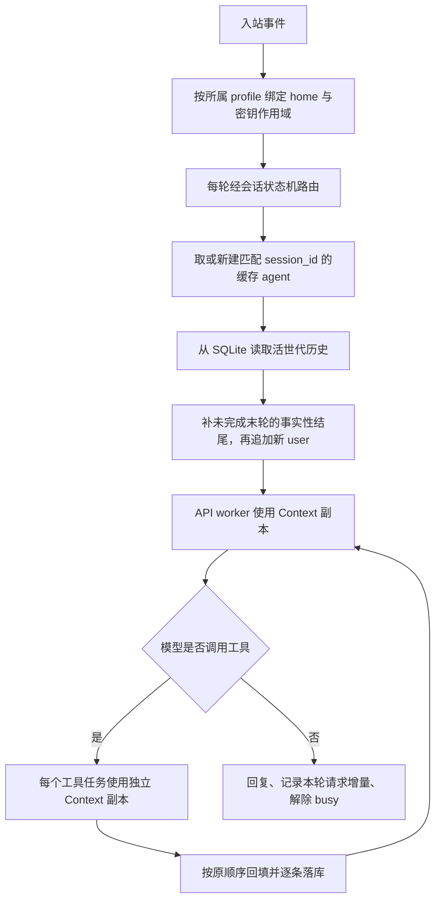

# 发布前修复记录

基线提交：`704f08b`。本次维护于 2026-10-14 修复发布前审查确认的 **19 项代码问题**、**1 项启动路径文档问题**，并补齐与线程作用域相关的工具探测缓存隔离。

## 修复与验证对应表

| 审查项 | 修复后的行为 | 回归验证 |
|---|---|---|
| F01 网关历史 | 未显式传历史时，agent 在追加本轮 user 前从 SQLite 读取活世代；显式空历史仍表示从空开始 | 同一会话两轮及重建网关后，直接检查真正发出的消息数组 |
| F02 API 线程作用域 | 使用 `copy_context()` 把 home 与密钥作用域复制到 API worker | 多路复用中，worker 读到次级 profile 的 home 和假凭据 |
| F03 并行工具作用域 | 每个工具任务使用独立 Context 副本，结果仍按调用顺序回填 | 两个实际 `skill_view` 调用都返回次级 profile 的正文 |
| 关联缓存隔离 | `check_fn` 的 TTL 与成功宽限都以 `(函数, 当前 home 解析路径)` 分桶 | A 有密钥、B 无密钥、再回 A，不复用错误的可用性结论 |
| F04 子命令 profile | 先处理全局 `-p`，再分发子命令；网关 status/stop 的单 home 模式查询当前 home | 对两个物理目录分别验证 sessions、gateway run/status/stop 与不存在的名字 |
| F05 中断与失败恢复 | 只为未完成末轮补事实性结尾；缺工具结果明确写“状态未知”，不假称操作没有发生 | 中断、网络失败、工具批次异常、进程中途退出留下的 user 尾部，均能接下一轮；原话和已发生的副作用保留 |
| F06 引擎接口 | 按签名过滤辅助调用关键字；缺可选 token 展示能力时调用 `describe()` | 只实现 3 个必需成员的最小引擎，通过不压缩和触发压缩两条路径 |
| F07 LIKE 检索 | 参数按 SQL 占位符顺序绑定：片段查询词 → WHERE → LIMIT/OFFSET | 中文与 FTS 降级路径均覆盖来源、角色过滤和命中片段 |
| F08 过新库保护 | 在写连接切换 WAL 前通过独立只读连接检查版本，DDL 前再检查一次 | 拒绝后 schema、journal mode、主文件字节均不变，未创建 WAL 侧文件 |
| F09 HTTP 端点 | 按 http/https 选择连接、默认端口；追加请求路径时保留 query | 明文 HTTP、TLS、自定义端口和 query 的连接参数验证 |
| F10 审批归属 | 待审批状态按会话键分开，核对发起者；同一会话不覆盖已有审批，已决审批不重复采纳 | 其他会话和同一聊天的其他用户都不能代批 |
| F11 审批通知 | 每轮将审批回调绑定到当前事件，直接向该事件投递通知；异常和超时都清理状态 | 通知确实进入 outbox，发起者能批准，完成后 pending 表为空 |
| F12 用量次数 | `iterations_used` 为本轮增量，`iterations_total` 为会话累计；`api_calls` 独立统计逻辑请求，写库使用它 | 两轮各一次；同一迭代回退两次；辅助摘要计数；CLI 落库包含回退请求 |
| F14 profile 名字 | 选择与创建复用同一个名字校验，并检查解析后的目录不逃出 profiles 根 | 绝对路径、`..`、空白非法名字拒绝；合法名字与 default 保留原语义 |
| F15 新会话状态 | `reset_session()` 统一重置任务、压缩引擎、微压缩状态、预算、提示词缓存，并收回主 provider | `/new` 后旧任务、批量摘要和滚动摘要都不残留 |
| F16 命令退出可见 | 终端非零退出返回带退出码、stdout/stderr 的错误结果 | 安全命令 `exit 7` 的进度与观察者都能看见失败及退出码 |
| F17 会话路由 | 每轮都先经状态机路由，再判断是否复用缓存 agent | 缓存命中仍更新活动时间；suspended 会话必须轮转 |
| F18 单次退出码 | 预算耗尽与 error 一样返回非成功退出码 | `--max-turns 0 -q ...` 未执行任务时不报 shell 成功 |
| F19 缓存 busy | `finally` 一律解除 busy，pending_flush 另按完成情况保留 | 前置异常后已空闲，未确认落盘的保护仍在 |
| F20 停止与收尾 | SIGTERM 进入同一个 finally；中断活跃回合、唤醒审批、限时等待、断开适配器、关闭可释放的库 | 真实网关子进程经 `gateway stop` 退出 0，状态 stopped、PID 删除、写 clean 标记；活跃回合保留软恢复状态 |
| D01 README 入口 | 根目录示例使用实际存在的 `./mini-hermes/mini` | 从仓库根实际运行 `--list-toolsets` 成功 |

F13 的“次级 console outbox 为空”没有计入原审查的 bug 数量：当前产品共用一个终端输出出口，本次保留这个行为。

## 对话与作用域的调用顺序

“Context 副本”指 Python `contextvars.copy_context()` 捕获的上下文变量集合；不通过修改全进程的 `os.environ` 来传递另一套 profile 凭据。

## 测试口径与实测

新增 `mini-hermes/tests/test_publish_regressions.py`，为跨子系统接线与发布入口提供独立测试；原有测试继续守各自的机制。本文件的每组测试都隔离 HOME、临时目录和假凭据，不调用真实模型。

- 当前新增回归：**86 通过 / 0 失败**，6 组。
- 全套：Python 3.13.14 **1,674 通过 / 0 失败**；Python 3.9.6 **1,670 通过 / 0 失败**，各 **15 个测试文件**。
- 干净环境：把本轮源码复制到临时目录，使用独立 HOME、TMPDIR 和不带个人密钥的环境，双解释器结果同上。
- 反向验证：仅在临时副本里逐项换回旧实现，**22 组全部干净变红**；包括线程、历史、目标库、审批、数据库保护、计数、退出和 README 路径。失败由测试诊断输出，不是整个套件无法启动。
- 临时目录均在 finally 中删除。进程身份检查需要运行环境允许 `ps`；第一次受限沙箱中的 PID 查询失败不计作源码问题。

`api_calls` 统计每次模型逻辑请求，包含回退和辅助摘要；同一请求的底层连接重试沿用一个请求 ID，不重复计数。此口径与观察者请求边界一致。

未完成轮次的补全只针对末尾，不悄悄重写历史中间的非法角色序列。工具结果未知时，模型收到的是明确的未知状态；需要检查文件或其他副作用，不能靠占位文字猜测。

## 文档与冻结口径

章节交付时的规模、历史提交和粘贴的真实测量记录保留。受影响的 mini 行号引用以源码语句、引文和方法重新定位，未按统一位移替换；当前规模见根 README 与《收尾总览》。上下文引擎讲解的全部节标题已和修复前副本逐项核对，章节结构完整。

本轮是冻结后的维护修复，作为本地维护提交保存；历史章节标签和旧 `final-v1` 冻结点保留。发布时应使用维护后的 main；旧 `704f08b` 仅是审查基线，不代表这些问题已修好的状态。

## 章节文档同步与全文复核

本轮从第一章开始复核。上轮代码修复涉及的第 2、4、6、7、7.1、7.2、8、11、14、15 章，已补当前行为说明；精译链接到对应讲解，历史提交和实测输出仍按原时点保存。

确认并修正的问题：

- 第一章混淆斜杠命令注册表与 CLI 子命令、把门面写成全部实现、把自动发现写成自动暴露；终端后端数改为上游锚点的 7 个。
- 第二章把只读预算属性说成消费操作、误称 mini 有 `refund()`；当前并发、恢复、中断和统计口径补入维护节。
- 第三章与第十三章把“变化点越靠前”解释成缓存损失最小；改为准确的公共前缀与后缀关系。第三章删去未经测量的账单倍数和七天重算量推算，说明 70/20 截断余量不能保证严格字符上限。
- 第四章仍用“单 profile”解释不分缓存键；第十一章仍用“无常驻网关、无外部持有者”解释恢复缺失，且混淆显式与 SQLite 自动 checkpoint；分别修正，真实保护差距保留。
- 第十章“用户消息永不压缩”限定为微压缩路径；插件引擎配置示例避免重复的活动 YAML 键。
- 修复官网相对链接、内部锚点、未闭合的 details / 错误代码围栏、额外一级标题；公开示例中的个人路径与主机名通用化。

全量结构检查覆盖 **33 篇**：实际 Markdown H1 均仅在第一行，代码围栏与 details 均闭合，本仓链接目标存在，历史锚点与当前维护口径分别说明。`README.md` 和《收尾总览》的文档行数按 `wc -l` 重新取得。

验证：隔离 HOME、空凭据环境的双解释器全套仍为 **1,674 / 1,670 通过，0 失败**。Python 改动仅纠正相关注释；函数与类的可执行语句保持相同。

**通读完成**：第 1–15 章及扩展 7.1、7.2，共 17 篇精译、16 篇源码讲解，已按章节从头复核正文与附录。第二轮继续修正以下问题：

- 压缩阈值的窗口地板、辅助窗口约束、保护头尾和失败后保留范围；微压缩的交换数上限不等于 token 或延迟上限。
- 会话库、网关队列、缓存、恢复与多 profile 的过时描述；缓存 agent 不等于缓存历史，进程退出不等于会话终结。
- provider 回退标志与候选链、凭据解析入口、HTTP 连接行为；明确逻辑请求、传输重试和预算迭代的不同计数。
- FTS 损坏分类、LIKE 与全文检索的语义差异、自动 checkpoint 和修复时其他进程持有数据库的真实边界。
- 后台完成通知样本与标签含义、技能 secret 的误译、内置/用户技能来源、auto_load 的正文例外，以及路径安全与内容信任的区别。
- 上下文引擎的重置路径、默认钩子成本、缓存公共前缀；修复 YAML 示例时保留上游原文证据，不能连引文也改成注释。
- 观察者的真实事件顺序、逻辑请求 ID、规范载荷与兼容对象的范围，并修正示例统计与 README 中已过期的未实现项。

当前行为说明与章节历史收据分别标明。根 README、mini README 和收尾总览中的当前文档行数统一按 `wc -l` 更新；旧提交的规模与实测输出保留原时点，不作为当前工作树的数字。

逐章文档复核提交 `fcf5506` 的两个 Python 文件只改注释或 docstring；去掉 docstring 后与维护基线的 AST 完全相同。隔离副本首次因缺根 README 导致发布入口检查报文件不存在，补齐夹具后重新跑完整套件；这属于验证副本遗漏，未修改产品或断言规避失败。

补充验证：`ch13_real_run.py`、`ch13b_real_run.py`、`ch14_real_run.py`、`ch15_real_run.py` 四个离线演示均在独立 HOME、空凭据环境下通过双解释器运行，退出码全部为 0；临时副本与演示目录均已清理。

## 后续实测 · 会话库只读体检

继续核验“bug、零依赖、文档与实现一致性”时，又复现并修复两项体检问题：

| 问题 | 旧行为 | 修复与反向验证 |
|---|---|---|
| SQLite URI 未编码 | MINI_HOME 含 `#` / `?` 时地址被截断，可能打开或创建错误文件；`%` 也影响解析 | 使用绝对路径的 `as_uri()` 后追加只读参数；三种特殊路径验证目标行数、主文件不变且不产生错误路径文件 |
| 没实际读取 FTS 索引 | 删除 FTS 表、保留权威消息与同步触发器时，check-only 仍报健康 | 额外执行只读 MATCH 探测；读取失败则单列病因、healthy=False、CLI 退出 1；通过时也只称“基础体检通过” |

新增 13 条断言登记在原状态库恢复套件第 11 组，测试临时目录均自动清理。第十一章维护说明、源码注释及总览已同步；历史章末数字保持原时点。总览中已完成的缓存隔离与多 profile 多库移出未实现口径。

实测结果：普通运行与 `python -S` 禁用 site-packages 的隔离运行，双版本全套均为 **1,687 / 1,683 通过，0 失败**（各 15 个测试文件）。新增状态库套件为 **134 / 130 通过**。分别换回旧 URI 打开函数和旧体检函数，分别 **4 / 3 条干净变红**，无用例异常；反验仅在临时副本完成。

零依赖启动核验：两个解释器均以 `-S` 启动命令行，`--help`、`--list-toolsets` 正常退出；空凭据单次问答返回明确的配置失败与非零退出码，没有缺包或 traceback。真实模型调用仍需要使用者配置 API 凭据和网络，本轮未调用外部模型。

## 收尾 · 临时目录与发布自检

4 个旧测试和 4 个 demo 的临时目录已归入各脚本自有的 TemporaryDirectory 根，所有子目录在 finally 一并清理，导入或配置失败也有自动清理兜底。只删除本次运行创建的目录，未扫描或删除用户历史 TMPDIR 内容。

发布自检新增 16 条黑盒断言，检测早期失败后的真实文件系统残留；第十一章 demo 补上辅助连接关闭和失败退出码，缓存演示恢复其临时替换的 Path.read_text。正常运行的全套测试也逐文件检查 TMPDIR，避免只凭源码中出现 rmtree 就宣称不漏。

额外修正两处验收问题：发布自检的默认凭据路径断言先隔离调用环境的 MINI_HOME；第十一章 demo 使用 `python -m hermes_cli.main` 核验 CLI，而非把文件入口的导入失败误称为依赖缺失。当前 SQLite 若禁止修改 FTS 影子表，演示明确跳过这条物理造坏路径，仍执行文件损坏与 CLI 检查；正文说明同步到对应章节。

反向验证：在临时副本换回 8 个脚本的旧写法，新增检查中 **8 条残留断言干净变红**，探针本身均正常执行，套件退出 1。没有以测试崩溃冒充检出。

最终验收：隔离 HOME、空凭据、`-S` 禁用 site-packages，Python 3.13 / 3.9 全套 **1,703 / 1,699 通过，0 失败**，各 15 个测试文件运行后 TMPDIR 均为空；发布自检为 **34 通过，0 失败**。六个离线 demo（状态库损坏、缓存、技能、凭据、引擎、观察者）在双版本均退出 0，无临时残留。两个真实模型 demo 仅验证无凭据的早期失败清理，本轮未调用外部模型。

公开文件复查并移除代码解读附录中的最后一处个人绝对路径；密钥形状命中均为脱敏测试的固定假值。上游文档镜像仍被忽略且未跟踪，既有章节标签及 final-v1 冻结点保持不动。

## 首次公开发布 · 历史脱敏与许可

公开副本保留全部 156 个开发提交及 18 个标签（17 个章节里程碑与 final-v1），替换历史中的个人路径、主机提示符与个人提交邮箱，并同步本仓提交引用。提交身份使用 ICTQYC 的 GitHub noreply 邮箱；旧邮箱不随公开历史分发。脱敏不改变当前 Python 可执行语义，私有开发仓保留原历史。

核对固定上游提交的 MIT 许可，新增 THIRD_PARTY_NOTICES.md，保留 Nous Research 的版权及许可全文；中文与英文首页均链接该通知。

公开副本验证：103 个 Python 文件与开发仓的可执行 AST 一致；全部可达旧历史对象的隐私复核通过，正文不再引用旧的本仓提交 ID。最终隔离双版本全套为 **1,703 / 1,699 通过，0 失败**，15 个文件逐个运行后无临时目录残留。

## Web 演示 · 对话、轨迹与运行状态

新增 `hermes_cli/web.py` 与原生静态页面，入口 `mini --web` / `--web-port` 在构造 MiniCLI 之前分发；默认离线无需凭据。离线固定 provider 驱动真实 Agent、工具和临时 SQLite，真实模式沿用后端配置并使用独立 Web 会话库。页面展示七类观察者事件、状态、用量和耗时，支持会话切换、停止及既有危险命令审批。

适配层处理 Agent 缓存的每回合预算、工具 JSON 后附预算提示的解析、连接断开、审批停止竞态与并发审批串行化。静态资源使用固定路由，HTTP 校验回环 Host、同源 Origin、页面令牌及请求大小；前端以纯文本呈现工具和用户内容。原观察者契约和 Agent 主循环未修改。会话列表在内存中，本版未提供服务重启恢复或模型逐 token 输出，边界见 WEB_DEMO.md。

新增 64 条标准库集成断言（5 组），覆盖真实离线工具、SSE 提前读取与收口、工作区与数据库隔离、来源拒绝、审批、中断、断开清理，以及假 provider 驱动的真实模式入口。双解释器 `-S` 隔离全套 **1,767 / 1,763 通过，0 失败**，共 16 个测试文件，逐文件 TMPDIR 无残留。真实外部模型本轮未调用。

反向验证只在临时副本进行：撤掉缓存 Agent 的回合预算重置，1 条断言干净变红；撤掉 HTTP 来源校验，2 条断言干净变红；均无用例异常，退出码为 1，临时目录已清理。

## 章节演示与真实模型入口

- 章节目录覆盖 17 篇精译入口，明确区分文档导览、隔离机制实验与 Agent 实跑。压缩/微压缩、SQLite 恢复/搜索、路由队列、profile、Provider 判据、状态恢复、技能、引擎等展示真实模块的实测证据；未实现项和固定摘要夹具明确标注。
- Web 可输入 DeepSeek API Key 和模型名，仅保留本次服务内存；固定官方端点，通过现有密钥作用域读取。浏览器不保存密钥，响应与错误在进入核心历史/落盘前脱敏；更新/清除使旧 Agent 缓存失效。真实 Web 回合禁用自动 fallback。
- Agent 传输新增可选 thinking 参数，默认请求保持原协议；Web DeepSeek 使用非思考模式。新增 72 条断言、4 组测试；双版本隔离全套 **1,839 / 1,835 通过，0 失败**，17 个测试脚本（另有 1 个测试包入口），逐文件 TMPDIR 无残留。
- 三项反验均干净变红：移除响应脱敏 2 红、移除 thinking 请求字段 1 红、忽略章节路由 5 红，无用例崩溃。浏览器验收章节切换、实际证据、假密钥保存/不回显/清除与桌面/手机布局。真实外部模型本轮未调用，首次连接由使用者填写密钥后发送任务验证。
- 中英入口、Web 指南、对应讲解与当前统计同步。显式 mini 引用按原源码引文及上下文反查新位置，共更新 50 处；旧章节交付快照保持原数字。本次仍只保留本地，未推送。

## 提示词装配演示：改为当前对话的逐次请求

第 3 章不再独立跑两次 builder 当演示，而是在真实 Agent 装配时记录三层产物、在传输前捕获最终 messages，核实对应关系后展示。支持查看每次请求的分层原文、临时指导、完整系统消息和历史/工具消息，并与前一次请求比较。离线对话生成身份/项目规则/记忆文件，真实模式复用同一入口；第一章只保留文档导览。其他章节保留原有演示，后续逐章调整。

双版本隔离全套 **1,854 / 1,850 通过，0 失败**（17 个测试脚本）。Web 章节套件现在 87 条，覆盖逐次快照与真实 provider 入参一致、多轮缓存、新会话重建、长提示词完整读取、真实路径续聊和架构章不运行。移除装配分层记录后 **3 条干净变红**。浏览器核验对话续聊、回看旧请求、层内容与比较、第一章导览；本轮未调用外部模型。快照只在服务内存保存，已知密钥先脱敏，字节稳定不等于服务商缓存命中。

## 按适用性扩展详细章节演示

保留第 3 章，补齐循环、会话存储、技能和观察者的当前对话查看器：保存实际模型请求/响应、关联真实工具结果与下一请求，展示当前数据库行、恢复后续聊、技能正文进入上下文的时点以及观察者失败放开。另为工具、全量压缩、Provider、微压缩、状态恢复、上下文引擎提供 6 个可操作隔离实验；支持参数与连续操作，展示完整输入输出和实际分支。原消息去向与新上下文结构可对照查看。网关系列及架构/集成/归属章节保留导览，不提供模拟运行。

新增 `tests/test_web_chapters.py` **59 条 / 3 组**，原章节套件因 06/13 转为真实对话调整为 **84 条 / 5 组**。双解释器隔离全套 **1,910 / 1,906 通过，0 失败**（18 个测试脚本，逐文件 TMPDIR 无残留）。反验：移除工具闸门 **1 红**、不丢弃旧 Agent 内存 **2 红**、跳过技能正文加载 **1 红**；均干净失败、无用例崩溃、无临时残留。

浏览器核对实际工具写读、会话从库恢复后续聊、HTTP 错误回退路径、连续微压缩、状态恢复、引擎选择，以及桌面/手机布局。修正动态选择控件的显式标签关联。实验只写入服务拥有的临时目录；已知 Web 密钥不能误写入实验参数。真实模型讲解接收本次实验的明确截取片段，不偷偷重跑另一份实验。真实外部 API 本轮未调用。中英入口、操作说明、对应章节维护说明与当前统计同步。

## Web 发布前复核

修正三个界面问题：同一请求的并发刷新可能重复追加工具结果；快速操作可能并发创建会话；返回已有实验会话时控件选择会重置。请求查看器增加版本校验，创建会话期间禁用重复操作，实验参数选择按会话保存在当前页面内存。修正 Web 指南中旧的统一运行步骤，按对话、实验和导览分别说明；中英首页补齐 clone、启动、地址、更换端口与退出命令，更新演示截图入口。

双版本隔离全套仍为 **1,910 / 1,906 通过，0 失败**，18 个测试脚本逐文件无临时残留。另以可控异步响应执行实际 JavaScript 函数：旧版同一请求产生 6 个详情块、并发发送 2 次创建请求；修复后分别为 4 个详情块和 1 次创建请求。浏览器核验非默认压缩参数、27 → 10 条实际结果、会话切换后参数保留、循环请求/工具回填与架构导览，未报告脚本错误。

两个解释器均从空 HOME、空凭据并禁用 site-packages，通过真实启动器启动服务，核对静态资源、章节 Markdown、离线工具回合、Ctrl-C 退出及临时数据清理；无需安装第三方包。真实外部 DeepSeek API 未调用，真实请求体、密钥生命周期与脱敏由假 provider 测试覆盖；实际连接需填写账号密钥后发送任务验证。
