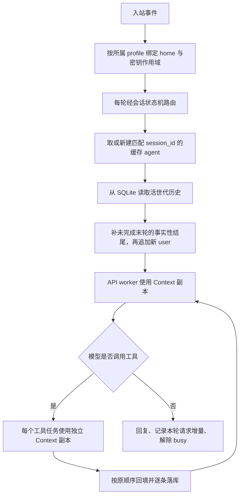

# 发布前修复记录

基线提交：`704f08b`。本次维护于 2026-10-14 修复发布前审查确认的 **19 项代码问题**、**1 项启动路径文档问题**，并补齐与线程作用域相关的工具探测缓存隔离。

## 修复与验证对应表

| 审查项 | 修复后的行为 | 回归验证 |
|---|---|---|
| F01 网关历史 | 未显式传历史时，agent 在追加本轮 user 前从 SQLite 读取活世代；显式空历史仍表示从空开始 | 同一会话两轮及重建网关后，直接检查真正发出的消息数组 |
| F02 API 线程作用域 | 使用 `copy_context()` 把 home 与密钥作用域复制到 API worker | 多路复用中，worker 读到次级 profile 的 home 和假凭据 |
| F03 并行工具作用域 | 每个工具任务使用独立 Context 副本，结果仍按调用顺序回填 | 两个实际 `skill_view` 调用都返回次级 profile 的正文 |
| 关联缓存隔离 | `check_fn` 的 TTL 与成功宽限都以 `(函数, 当前 home 解析路径)` 分桶 | A 有密钥、B 无密钥、再回 A，不复用错误的可用性结论 |
| F04 子命令 profile | 先处理全局 `-p`，再分发子命令；网关 status/stop 的单 home 模式查询当前 home | 对两个物理目录分别验证 sessions、gateway run/status/stop 与不存在的名字 |
| F05 中断与失败恢复 | 只为未完成末轮补事实性结尾；缺工具结果明确写“状态未知”，不假称操作没有发生 | 中断、网络失败、工具批次异常、进程中途退出留下的 user 尾部，均能接下一轮；原话和已发生的副作用保留 |
| F06 引擎接口 | 按签名过滤辅助调用关键字；缺可选 token 展示能力时调用 `describe()` | 只实现 3 个必需成员的最小引擎，通过不压缩和触发压缩两条路径 |
| F07 LIKE 检索 | 参数按 SQL 占位符顺序绑定：片段查询词 → WHERE → LIMIT/OFFSET | 中文与 FTS 降级路径均覆盖来源、角色过滤和命中片段 |
| F08 过新库保护 | 在写连接切换 WAL 前通过独立只读连接检查版本，DDL 前再检查一次 | 拒绝后 schema、journal mode、主文件字节均不变，未创建 WAL 侧文件 |
| F09 HTTP 端点 | 按 http/https 选择连接、默认端口；追加请求路径时保留 query | 明文 HTTP、TLS、自定义端口和 query 的连接参数验证 |
| F10 审批归属 | 待审批状态按会话键分开，核对发起者；同一会话不覆盖已有审批，已决审批不重复采纳 | 其他会话和同一聊天的其他用户都不能代批 |
| F11 审批通知 | 每轮将审批回调绑定到当前事件，直接向该事件投递通知；异常和超时都清理状态 | 通知确实进入 outbox，发起者能批准，完成后 pending 表为空 |
| F12 用量次数 | `iterations_used` 为本轮增量，`iterations_total` 为会话累计；`api_calls` 独立统计逻辑请求，写库使用它 | 两轮各一次；同一迭代回退两次；辅助摘要计数；CLI 落库包含回退请求 |
| F14 profile 名字 | 选择与创建复用同一个名字校验，并检查解析后的目录不逃出 profiles 根 | 绝对路径、`..`、空白非法名字拒绝；合法名字与 default 保留原语义 |
| F15 新会话状态 | `reset_session()` 统一重置任务、压缩引擎、微压缩状态、预算、提示词缓存，并收回主 provider | `/new` 后旧任务、批量摘要和滚动摘要都不残留 |
| F16 命令退出可见 | 终端非零退出返回带退出码、stdout/stderr 的错误结果 | 安全命令 `exit 7` 的进度与观察者都能看见失败及退出码 |
| F17 会话路由 | 每轮都先经状态机路由，再判断是否复用缓存 agent | 缓存命中仍更新活动时间；suspended 会话必须轮转 |
| F18 单次退出码 | 预算耗尽与 error 一样返回非成功退出码 | `--max-turns 0 -q ...` 未执行任务时不报 shell 成功 |
| F19 缓存 busy | `finally` 一律解除 busy，pending_flush 另按完成情况保留 | 前置异常后已空闲，未确认落盘的保护仍在 |
| F20 停止与收尾 | SIGTERM 进入同一个 finally；中断活跃回合、唤醒审批、限时等待、断开适配器、关闭可释放的库 | 真实网关子进程经 `gateway stop` 退出 0，状态 stopped、PID 删除、写 clean 标记；活跃回合保留软恢复状态 |
| D01 README 入口 | 根目录示例使用实际存在的 `./mini-hermes/mini` | 从仓库根实际运行 `--list-toolsets` 成功 |

F13 的“次级 console outbox 为空”没有计入原审查的 bug 数量：当前产品共用一个终端输出出口，本次保留这个行为。

## 对话与作用域的调用顺序

“Context 副本”指 Python `contextvars.copy_context()` 捕获的上下文变量集合；不通过修改全进程的 `os.environ` 来传递另一套 profile 凭据。

## 测试口径与实测

新增 `mini-hermes/tests/test_publish_regressions.py`，为跨子系统接线与发布入口提供独立测试；原有测试继续守各自的机制。本文件的每组测试都隔离 HOME、临时目录和假凭据，不调用真实模型。

- 当前新增回归：**86 通过 / 0 失败**，6 组。
- 全套：Python 3.13.14 **1,674 通过 / 0 失败**；Python 3.9.6 **1,670 通过 / 0 失败**，各 **15 个测试文件**。
- 干净环境：把本轮源码复制到临时目录，使用独立 HOME、TMPDIR 和不带个人密钥的环境，双解释器结果同上。
- 反向验证：仅在临时副本里逐项换回旧实现，**22 组全部干净变红**；包括线程、历史、目标库、审批、数据库保护、计数、退出和 README 路径。失败由测试诊断输出，不是整个套件无法启动。
- 临时目录均在 finally 中删除。进程身份检查需要运行环境允许 `ps`；第一次受限沙箱中的 PID 查询失败不计作源码问题。

`api_calls` 统计每次模型逻辑请求，包含回退和辅助摘要；同一请求的底层连接重试沿用一个请求 ID，不重复计数。此口径与观察者请求边界一致。

未完成轮次的补全只针对末尾，不悄悄重写历史中间的非法角色序列。工具结果未知时，模型收到的是明确的未知状态；需要检查文件或其他副作用，不能靠占位文字猜测。

## 文档与冻结口径

章节交付时的规模、历史提交和粘贴的真实测量记录保留。受影响的 mini 行号引用以源码语句、引文和方法重新定位，未按统一位移替换；当前规模见根 README 与《收尾总览》。上下文引擎讲解的全部节标题已和修复前副本逐项核对，章节结构完整。

本轮是冻结后的维护修复，作为本地维护提交保存；历史章节标签和旧 `final-v1` 冻结点保留。发布时应使用维护后的 main；旧 `704f08b` 仅是审查基线，不代表这些问题已修好的状态。
